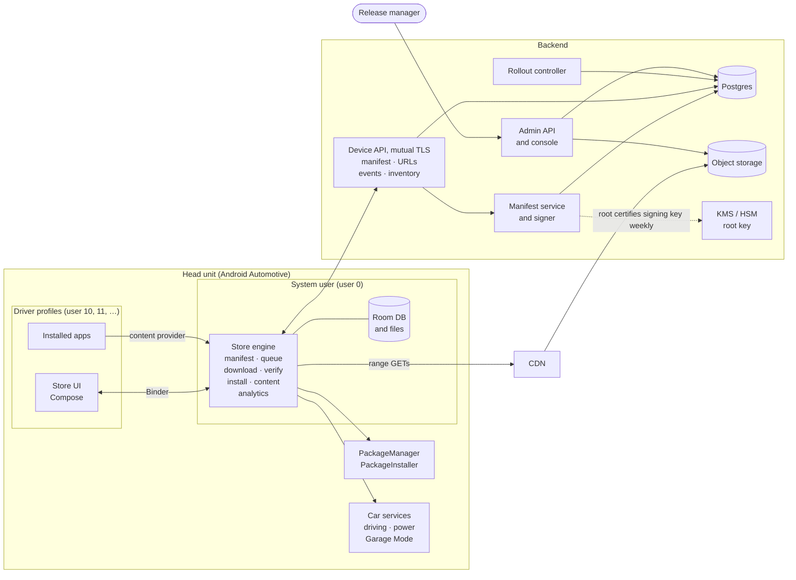
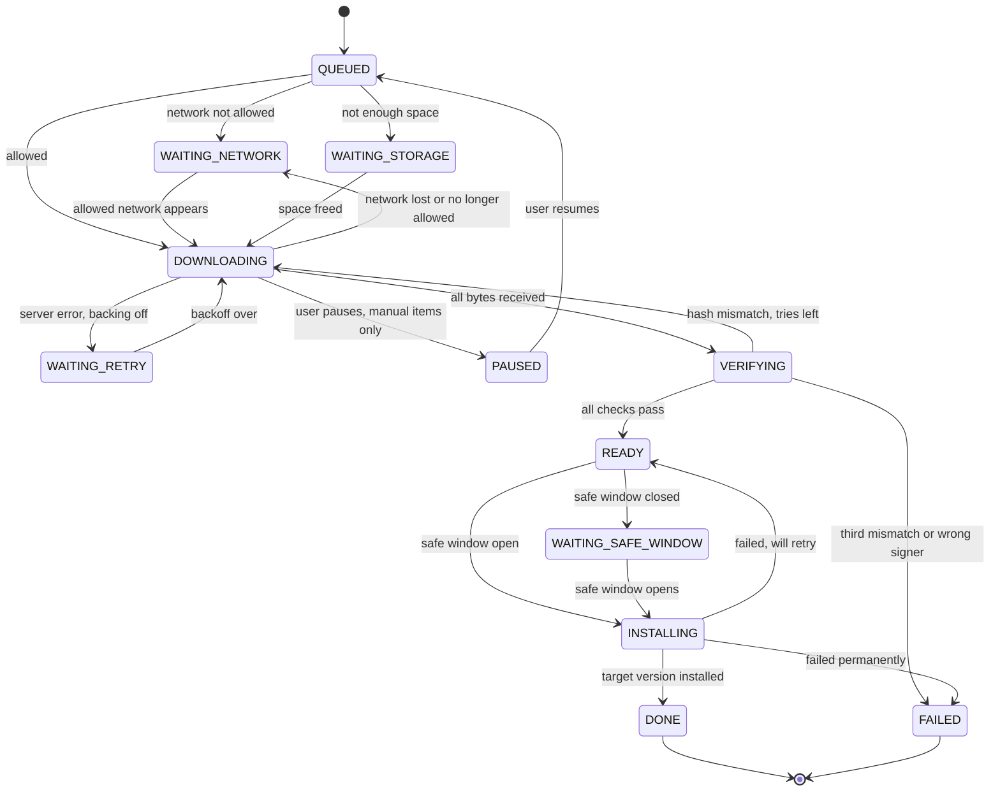
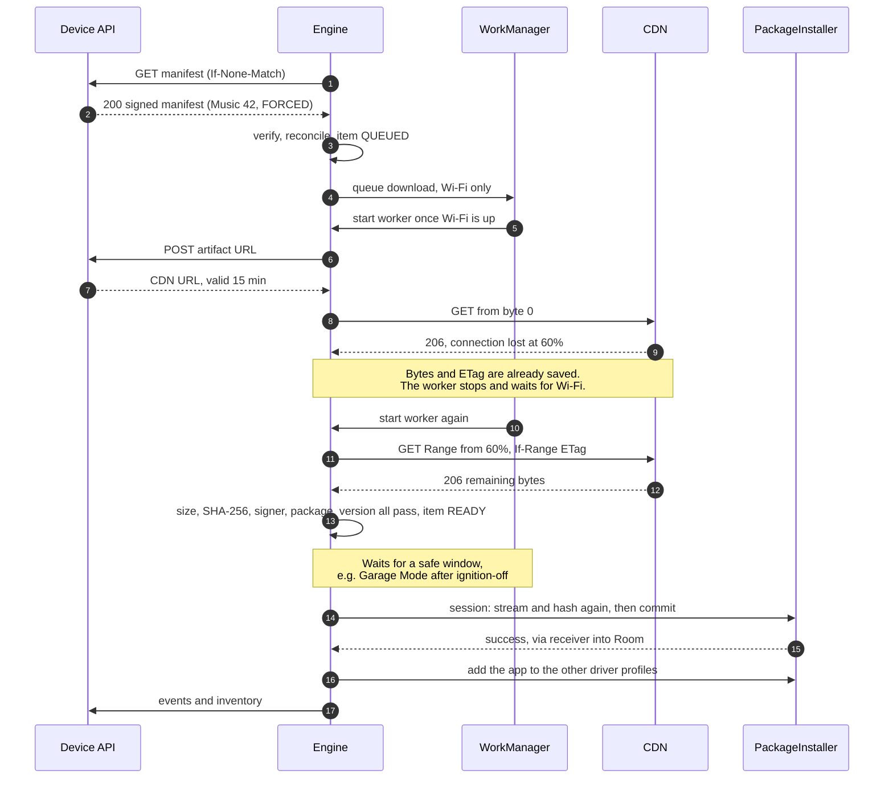
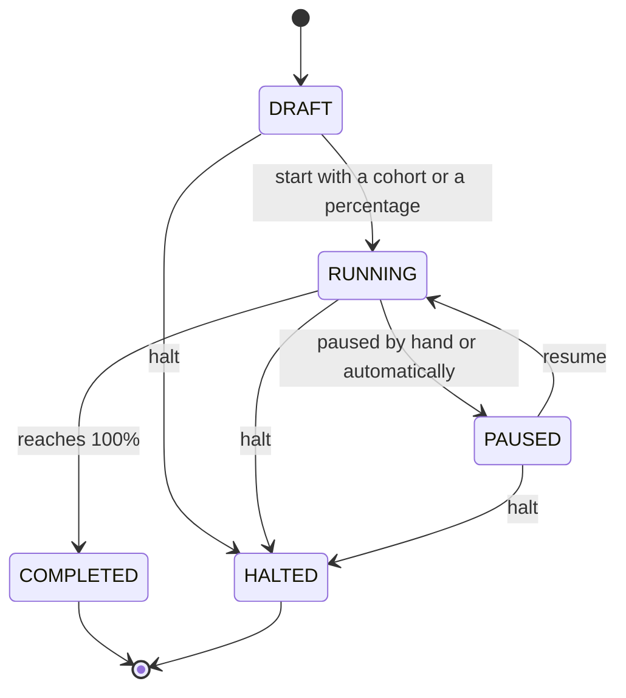

# Automotive App Store — Design

**Status:** Draft for approval · **Date:** 2026-09-25 · **Implements:** [REQUIREMENTS.md](REQUIREMENTS.md) v2, approved 2026-09-25 · **Next step after approval:** code, one milestone at a time

This document describes how the app store meets the approved requirements. IDs such as NET-05
refer to REQUIREMENTS.md. Four design choices need your decision before coding starts. They are
collected in §16.

Step-by-step flow diagrams for every scenario are in [FLOWS.md](FLOWS.md).

The diagrams are written in Mermaid, so any Mermaid-aware viewer draws them straight from this
file. Rendered copies, in SVG and PNG, are in [diagrams/](diagrams/). Export them again whenever a
diagram here changes.

---

## 1. Design at a glance

| # | Choice | Why |
|---|---|---|
| 1 | The server sends each vehicle a signed **desired state**, called the manifest. The vehicle compares it with what is installed and works toward it. There are no one-off remote commands. | Every step can be repeated safely, so lost connections, reboots and duplicate messages do no harm. |
| 2 | The store is one APK with two halves. The **UI** runs in the driver's profile. The **engine** runs once per vehicle, in the system user. | One queue and one download per vehicle. Installs reach every profile (D4), and downloads survive a change of driver. |
| 3 | Every file the store fetches (APK, content, icon) is bound to the signed manifest by its SHA-256 hash. | One root of trust. A compromised CDN or storage bucket cannot slip in a file. |
| 4 | WorkManager decides **when** a download may run: on which network, and after reboots. Our range downloader decides **how**: resume, ETag checks, chunk hashes. | This was decision D2. |
| 5 | Each transfer is bound to the network it was allowed on. | A Wi-Fi-only download can never quietly carry on over cellular (S1). |
| 6 | Installs wait for a **safe window**: the app is not in use and the battery is fine. Garage Mode, the maintenance window after ignition-off, is the main window for automatic installs. | NFR-01, INS-05, VEH-02. |
| 7 | The backend uses Kotlin and Ktor, Postgres, and object storage behind a CDN. Manifest signing is rooted in a KMS or HSM, and analytics go to our own ingest service. | No Google Play services (D3). The vehicle and the server share the manifest types. |

### 1.1 Assumptions

| # | Assumption | If it is wrong |
|---|---|---|
| A1 | The head unit runs Android 11 (API 30) or later. | The multi-user calls in §6.3 need hidden APIs on Android 10. |
| A2 | The platform build ships the store in the system image, signed with the platform key, and installs it for the system user and for driver profiles. | D1 cannot be met. |
| A3 | There is one driver display. Rear-seat screens with their own users are out of scope. | Occupant zones need their own design. |
| A4 | Every vehicle has a client certificate from the OEM's PKI. | API-02 needs another way to authenticate vehicles. |
| A5 | The CDN supports range requests, ETags and signed URLs. | Interrupted downloads restart instead of resuming. |

---

## 2. Architecture

### 2.1 System context



### 2.2 Two halves: UI and engine

On most Android Automotive builds the system user (user 0) is *headless*. It runs in the
background, and each driver has their own profile (user 10, 11, …). Android normally runs a
separate copy of an app for each user. If the whole store ran in the driver's profile, each
profile would download the same files, and switching drivers would cut downloads off.

So the store is split in two:

- **The engine runs in user 0.** Its service and content provider are declared
  `android:singleUser="true"`, so every profile talks to the same instance. The engine owns the
  manifest, the work queue (Room), the WorkManager jobs, the downloaded files and the content.
- **The UI runs in the driver's profile.** It holds only activities and view models, and it binds
  to the engine's service. A signature-level permission ensures only our own UI can bind.
- **The queue exists only once.** The `Application` class starts Room and WorkManager only in
  user 0, so a driver's process never creates a second queue.
- **Builds without a headless system user work the same way.** Where user 0 is also the driver,
  both halves share one process.

The engine's interface (AIDL), in outline:

| Call | Purpose |
|---|---|
| `getSnapshot()`, `registerListener()` | Rows, details and banner for the UI. Updates are pushed at most 4 times a second. |
| `install(pkg)`, `update(pkg)`, `updateNow(pkg)`, `uninstall(pkg)` | User actions |
| `pause(item)`, `resume(item)`, `cancel(item)` | Manual downloads only (DL-05) |
| `postpone(pkg)` | Answer to a forced-update prompt (TYP-02) |
| `setCellularAllowed(b)`, `setAutoUpdate(b)`, `setOptionalContent(id, b)` | Settings (UX-04, CON-06) |

### 2.3 Client modules

| Package | Main classes | Job | Requirements |
|---|---|---|---|
| `manifest` | ManifestClient, ManifestVerifier, ManifestStore | Fetch with ETag, verify, check sequence and expiry, cache on disk | CAT-04–06, API-01–04, INTG-01 |
| `reconcile` | Reconciler (pure), ReconcileWorker | Compare desired with installed; create, cancel and reprioritise work items | CAT-02, TYP-*, VER-05, UNI-06, INS-09/10, CON-03/06 |
| `queue` | WorkItemDao, ItemStateMachine | Durable work items and the legal moves between states | RES-03, VEH-05 |
| `net` | NetworkClassifier, NetworkPolicy (pure), DataBudget | Decide which network each item may use | NET-01–10 |
| `download` | RangeDownloader, DownloadWorker, UrlProvider | Resumable, chunk-checked transfer | DL-*, INT-*, RES-* |
| `verify` | ArtifactVerifier | Size, hash, signer, package, version, no downgrade | INTG-02–09 |
| `install` | SessionInstaller, InstallResultReceiver, ProfileInstaller, Uninstaller, Suspender | Installer sessions, all profiles, uninstall, suspend | INS-*, UNI-*, TYP-03 |
| `vehicle` | SafeWindowGate, DrivingState, AppUsage, PowerState | Is now a safe moment to install? | VEH-*, INS-05 |
| `content` | ContentStore, ContentActivator, ContentProvider | Stage, verify, activate, hand off, clean up | CON-* |
| `analytics` | EventLogger, EventQueue, UploadWorker | Durable events and upload | AN-01–15 |
| `ui` | Screens, view models, EngineClient | Catalogue, detail, settings, prompts | CAT-07, UX-*, VEH-01 |
| `manifest-model` (shared module) | kotlinx-serialization types | The same types on the vehicle and the server | API-06 |

These parts are reused from the prototype at git HEAD:

- SessionAppInstaller, with the fixes in §6.2
- AppStateResolver
- PackageManagerInspector, extended to read signing certificates
- ServiceLocator
- the test fakes
- the privapp-permissions file

### 2.4 What wakes the engine

No process runs all the time. The engine works when one of these triggers fires:

| Trigger | What the engine does |
|---|---|
| Boot, or wake from suspend | Recovery (§4.3), a manifest refresh if the cached one is over 1 h old, and an install sweep |
| Periodic job (default every 6 h, set by policy; needs network) | Manifest refresh, reconcile, partial-file cleanup (CAT-05) |
| Store UI opened | Manifest refresh if the cached one is over 5 min old (CAT-05) |
| A refresh failed for lack of network | Schedules a one-off refresh job that waits for a network (CAT-05) |
| A download's network constraint is met | WorkManager starts that download's worker |
| A package changes in any profile | Reconcile |
| A new driver profile is created | Reconcile, which installs the store's apps for that profile (INS-10) |
| A "check now" signal arrives (§9.7) | Manifest refresh after a random 0–10 min delay |
| An item becomes ready, the car is parked, or an app closes | Install sweep (§6.4) |
| Garage Mode (the device is idle after ignition-off) | Install sweep, content and partial-file cleanup, analytics upload |
| Month boundary | Reset the cellular data budget; re-queue items that were waiting on it |

---

## 3. Manifest contract v2

### 3.1 Device API

| Call | Purpose |
|---|---|
| `GET /v2/vehicles/self/manifest` | The signed manifest. Sends `If-None-Match`; gets `304` when unchanged (API-04). |
| `POST /v2/artifacts/{artifactId}/url` | A CDN URL valid for 15 min. `410` if the release was withdrawn, `403` if this vehicle is not entitled to it (DL-09, INT-07). |
| `POST /v2/events` | Upload a batch of analytics events (AN-11). |
| `PUT /v2/vehicles/self/inventory` | Installed app and content versions, sent whenever they change (AN-20, NFR-04). |

The vehicle is identified by its client certificate (mutual TLS, API-02), so no identifiers
travel in URLs. Request headers carry only non-personal facts: store version and OS API level.
The path starts with `/v2`, and the server keeps each API version working for as long as stores
using it are in the field (API-06).

### 3.2 Envelope and signature

```json
{
  "alg": "ES256",
  "signingKey": {
    "publicKey": "MFkwEwYHKoZIzj0CAQYIKoZIzj0DAQcDQgAE…",
    "notAfter": "2026-10-02T00:00:00Z",
    "rootKeyId": "root-2026",
    "rootSignature": "MEUCIQ…"
  },
  "payload": "eyJzY2hlbWEiOjIsImRldmljZUlkIjoi…",
  "signature": "MEQCIF…"
}
```

**Verify first, parse second.** The vehicle checks the signature over the exact payload bytes
before it parses any JSON inside them. This avoids JSON canonicalisation problems, and the parser
never sees unsigned input. The checks run in this order:

1. `rootKeyId` must name a root key pinned in the APK. The APK pins two: the current root and
   the next one.
2. The root's signature over the signing key's public key and expiry must verify, and
   `notAfter` must not have passed.
3. The payload's signature must verify under that signing key.
4. The payload is parsed, up to a 2 MB limit.
5. `deviceId` must be this vehicle's.
6. `sequence` must be at least that of the cached manifest. This blocks replay of an old
   manifest that still offered a withdrawn release.

If any check fails, the new manifest is ignored, the cached one stays in use, and
`manifest_rejected` is reported (CAT-06).

- **Algorithm.** ECDSA P-256 with SHA-256, which Android verifies natively on every version we
  support. Ed25519 only arrives in Android 13.
- **Why a signing key sits between root and manifest.** The root stays in the KMS or HSM and
  certifies a new 7-day signing key each week. The manifest service signs with that key in
  memory. A critical release changes every vehicle's manifest at once, and one KMS call per
  vehicle would be too slow and too costly (NFR-10).
- **Expiry.** Each manifest carries `expiresAt`, 30 days after issue. An expired manifest still
  drives the catalogue screen, but no new downloads or installs start from it. The server
  re-signs a manifest once it is half-way to expiry, so a vehicle whose manifest never changes
  still gets a fresh one.
- **Clock.** For deadlines, "now" is the later of the vehicle clock and the cached manifest's
  `issuedAt`. A vehicle clock that is behind cannot push a deadline back.

### 3.3 Payload

```json
{
  "schema": 2,
  "deviceId": "veh_5Q2k9x",
  "sequence": 1048576,
  "issuedAt": "2026-09-25T10:00:00Z",
  "expiresAt": "2026-10-25T10:00:00Z",
  "channel": "production",
  "policy": {
    "manifestRefreshMinutes": 360,
    "autoUpdateDefault": true,
    "maxParallelDownloads": 2,
    "cellular": { "defaultMaxItemMb": 50, "monthlyBudgetMb": 500 },
    "retry": { "initialSec": 5, "maxSec": 900, "maxAttemptsPerDay": 20, "stallSec": 30, "checksumRetries": 3 },
    "install": { "minBatteryPercent": 20, "forcedDeadlineDays": 14 },
    "storage": { "reservedFloorMb": 500, "partialMaxAgeDays": 14 },
    "drivingRateLimitKbps": 2000,
    "analytics": { "enabled": true, "sampleRate": 1.0, "disabledEvents": [] },
    "killSwitch": { "downloads": false, "installs": false }
  },
  "apps": [
    {
      "packageName": "com.example.music",
      "title": "Music",
      "category": "media",
      "description": "Stream your library.",
      "iconUrl": "https://cdn.example.com/icons/music-42.png",
      "iconSha256": "3f1c…",
      "availability": "AVAILABLE",
      "removable": true,
      "minSupportedVersionCode": 40,
      "release": {
        "releaseId": "rel_7H2",
        "versionCode": 42,
        "versionName": "4.2.0",
        "installType": "FORCED",
        "deadline": "2026-10-10T00:00:00Z",
        "maxPostpones": 3,
        "blockOldVersions": false,
        "releaseNotes": "Faster start-up.",
        "signerSha256": ["9f2c…"],
        "network": { "allowCellular": true, "maxCellularMb": 50, "allowRoaming": false },
        "artifacts": [
          {
            "artifactId": "art_91c",
            "kind": "BASE_APK",
            "sizeBytes": 48211332,
            "sha256": "5d41…",
            "chunkSize": 4194304,
            "chunkSha256": ["a1b2…", "c3d4…"]
          }
        ]
      },
      "content": [
        {
          "contentId": "music.voice.en-US",
          "version": 7,
          "required": true,
          "appVersions": { "min": 40 },
          "installType": "MANUAL",
          "network": { "allowCellular": false },
          "artifact": {
            "artifactId": "art_2b0",
            "kind": "CONTENT_ZIP",
            "sizeBytes": 310000000,
            "unpackedBytes": 420000000,
            "sha256": "e5f6…",
            "chunkSize": 4194304,
            "chunkSha256": ["…"]
          }
        }
      ]
    }
  ]
}
```

| Field | Meaning |
|---|---|
| `availability` | `AVAILABLE`: offered; installed when the user asks. `REQUIRED`: must be on the vehicle; installed automatically. `REMOVED`: the store uninstalls it if the store installed it (UNI-06). `DISABLED`: suspended; its data is kept (§6.5). |
| `release` | The one target release for this vehicle, already chosen by the rollout engine (§9.3). When it is absent, there is nothing newer for this vehicle. |
| `installType` | `MANUAL`, `FORCED` or `CRITICAL` (TYP-01). |
| `minSupportedVersionCode` | An installed version below this is updated as at least `FORCED` (VER-05). |
| `blockOldVersions` | Suspend the old version once the deadline has passed. Waits on decision D7 (TYP-03). |
| `signerSha256` | Allowed signing-certificate digests. It is a list so that keys can be rotated. |
| `network` | Per-release cellular and roaming rules (NET-04, NET-07). |
| `chunkSha256` | A hash for every 4 MB chunk (RES-06). Very large artifacts may later move this list to a separate file, bound by its own hash. |
| `iconSha256` | Icons are bound to the manifest too. |
| `content[].appVersions` | The range of app `versionCode`s this content works with (CON-03). |
| `policy` | Store policy (C3): refresh interval, retries, battery, storage floor, analytics switches, kill switch. The kill switch stops all new downloads or installs, critical ones included. |

Two safety rules protect the vehicle's apps:

- **Missing is not the same as removed.** An app that is missing from the manifest is left
  alone. Only an explicit `REMOVED` uninstalls anything.
- **The store only removes what it installed.** It uninstalls or suspends only packages whose
  installer of record is the store itself, and never system apps (UNI-05).

---

## 4. Work items and states

### 4.1 Work items

- **One item per target.** There is one work item per app or content package and target
  version. That key is unique, so the reconciler can run any number of times without creating
  duplicates.
- **Kinds.** `INSTALL` (a new app or an update), `CONTENT`, `UNINSTALL`, `SUSPEND`, `UNSUSPEND`.
- **Priority** (DL-06):
  1. `CRITICAL`
  2. `FORCED`, earliest deadline first
  3. installs the user asked for
  4. automatic manual updates
  5. optional content
- **What is stored in Room.** Each item's artifacts, with bytes done, ETag, chunks verified,
  URL and its expiry. Also the attempts made today, postponements used, the installer session
  ID and the last error.

### 4.2 State machine



- **State is saved before the action.** Every change of state is written to Room before the
  action it describes. For example, `INSTALLING` and the session ID are saved before the
  installer session is committed.
- **Cancelling.** Any state that is not final can move to `CANCELLED`: when a newer release
  supersedes the item, when the release is withdrawn, when the user cancels (manual items
  only), or when the app is uninstalled. Partial files are deleted.
- **Failure is final for that release.** `FAILED` does not retry the same release. A new
  manifest with a different release, or a retry by the user, creates a new item.

### 4.3 Recovery after power loss or a crash (VEH-05)

When the engine starts, it checks what Room says was in progress:

| Found in Room | Action |
|---|---|
| `DOWNLOADING` | Resume from the last verified chunk boundary, or from the file length if the artifact has no chunk hashes. Size and SHA-256 are still checked at the end. |
| `VERIFYING` | Verify again from the start. |
| `INSTALLING` | Look up the session and the installed version. Target version installed: `DONE`. Session still open: abandon it and return to `READY`. Neither: count a failed attempt and return to `READY`. |
| Content staged but not yet active | Finish the activation. It is safe to repeat. |

### 4.4 Reconciler rules

The reconciler is a pure function. It takes four inputs: the manifest, the installed versions in
each profile, the current work items and the settings. It returns a list of actions, and it runs
at every trigger in §2.4.

| Situation | Action |
|---|---|
| Not installed; `AVAILABLE` | Nothing. The app shows **Install**, and the user's tap creates a `MANUAL` item. |
| Not installed; `REQUIRED` | Item with the release's type, at least `FORCED`. |
| Installed below the release; `MANUAL` | Item only if auto-update is on. Otherwise the app shows **Update**. |
| Installed below the release; `FORCED` or `CRITICAL` | Item with that type. |
| Installed below `minSupportedVersionCode` | At least `FORCED`. The deadline is the release's, or `forcedDeadlineDays` from now. |
| Installed at or above the release | Nothing. Never downgrade (INTG-08). |
| `REMOVED`, and installed by the store | `UNINSTALL` item. It waits for a safe window. |
| `DISABLED` | `SUSPEND` item (§6.5). |
| An item's target is no longer in the manifest | `CANCELLED`: the release was withdrawn or superseded. |
| An installed app lacks required content that fits its target version | `CONTENT` item. Optional content only when the user chose it (CON-06). |
| A store app is missing from a driver profile | Add it to that profile (§6.3), but only in three cases: while the store installs or updates the app, when the profile is new, or when the app is `REQUIRED`. A driver who removed an app from their own profile in system Settings keeps it removed. |

---

## 5. Network, download and resume

### 5.1 Classifying the network (NET-01)

| Class | Rule |
|---|---|
| `NONE` | No network, not validated, or behind a captive portal (hotel or dealer Wi-Fi). |
| `ROAMING` | The network lacks the not-roaming capability. |
| `METERED` | Any cellular network, even one marked as not metered. Also Wi-Fi or Ethernet without the not-metered capability: phone hotspots, and networks the user marked as metered. |
| `UNMETERED` | Wi-Fi or Ethernet with the not-metered or temporarily-not-metered capability. |

Cellular always counts as metered. The user's "Wi-Fi only" choice is about the cellular link,
and some OEMs mark their built-in modem as not metered.

### 5.2 Which network an item may use (NET-02–09)

`NetworkPolicy.decide(item, settings, network, budget, policy)` returns either *allow* or *wait,
with a reason*. It is a pure function with a unit test for every row below.

| Network | `CRITICAL` item | Any other item |
|---|---|---|
| `UNMETERED` | Allow | Allow |
| `METERED` | Allow | Allow only if all four hold: the user allows cellular, the release allows cellular, the artifact is within the cellular size cap, and the monthly budget is not used up. Otherwise wait for Wi-Fi. |
| `ROAMING` | Allow only if the release allows roaming | Wait: roaming |
| `NONE` | Wait: no network | Wait: no network |

- **The size cap uses the artifact's full size**, so the user gets a stable answer ("this needs
  Wi-Fi") rather than one that changes as bytes arrive.
- **The budget check uses the bytes still to download.**
- **Critical items count toward the budget but are never stopped by it** (NET-09).

### 5.3 From decision to WorkManager constraint

Each item gets its own unique `DownloadWorker` job, named `download-<itemId>`. Its network
constraint is a full `NetworkRequest`, set through `Constraints.Builder.setRequiredNetworkRequest()`.
That call exists from WorkManager 2.9, which hands the request to JobScheduler on API 28 and later.

| The item may use | Network request |
|---|---|
| Wi-Fi only | Wi-Fi or Ethernet transport; not metered; internet; validated |
| Cellular, but not roaming | Internet; not roaming; validated |
| Anything, including roaming (critical only) | Internet; validated |

How this plays out:

- **Wi-Fi only means the Wi-Fi transport.** Asking for the transport, not just for "unmetered",
  keeps a Wi-Fi-only item off a modem that the OEM marks as not metered.
- **Losing the network is a pause, not a failure.** When the network stops matching, JobScheduler
  stops the worker. The bytes are already on disk, so the next run resumes from the last byte
  (NET-08, INT-01, INT-03). A lost network does not count as a retry.
- **Some changes are invisible to WorkManager.** When the user flips the cellular setting, the
  budget runs out, or policy changes, the engine re-queues the affected items with new
  constraints. Replacing a job costs nothing because the bytes are kept.
- **Each transfer is pinned to one network.** Inside the worker, the socket and DNS lookups are
  bound to the matched `Network` object. If Wi-Fi drops, the transfer dies with it instead of
  moving to cellular. This is what guarantees "no bytes sent on cellular" in S1.
- **Parallel downloads are capped** (DL-06). A semaphore shared by all workers allows
  `maxParallelDownloads` downloads at once (default 2). Critical items skip the semaphore and
  run as expedited work.
- **Long downloads run in the foreground.** For artifacts over 20 MB, the worker calls
  `setForeground()` so it is not cut off at the 10-minute job limit. Risk R2 in §13 covers the
  Android 15 limit on foreground services.

### 5.4 Range downloader (RES-01–07, INT-02–08)

For each artifact:

1. **Check space.** The allocatable space must cover the remaining bytes, plus install overhead,
   plus the reserved floor (DL-03, NFR-09). Install overhead is 2× the size for an APK and 1×
   the unpacked size for content. If there is not enough, the item goes to `WAITING_STORAGE`.
   Otherwise the space is reserved up front with `StorageManager.allocateBytes()`.
2. **Get a URL.** A cached signed URL is reused until 60 s before it expires. After that, a new
   one is requested.
3. **Request.** When some bytes are already on disk, the downloader sends
   `Range: bytes=<done>-` and `If-Range: <ETag>`.
4. **Stream.** Data is read 64 KB at a time. At each 4 MB boundary the downloader hashes the
   finished chunk against `chunkSha256`, flushes the file to disk, and then saves bytes done
   and chunks verified in Room. A bad chunk is cut off and fetched again, up to 3 times.
5. **Detect stalls.** The read timeout is `stallSec` (30 s). There is no overall timeout, so
   slow links are fine (INT-06, INT-08).
6. **Count bytes by network class,** for the data budget and analytics (NET-09, NET-10).

| Response | Meaning | Action |
|---|---|---|
| `206`, starting at the requested byte, same ETag | Resume accepted | Append |
| `206` with a different ETag | The CDN ignored `If-Range` | Truncate and start again from 0 |
| `200` | Range ignored, or the file changed | Truncate, start again, report the reason (RES-02, RES-05) |
| `416` | The requested start is at or past the end of the file | If the file is complete, verify it; otherwise truncate and start again |
| `401` or `403` from the CDN | The URL expired | Get a new URL and retry straight away from the same byte (INT-07) |
| `404` or `410` | Gone | Ask the API. A `410` there means the release was withdrawn: `FAILED`, and the partial file is deleted (INT-04). |
| `408`, `429`, `5xx`, timeout, connection reset | Transient | Retry with backoff (§5.5) |

### 5.5 Retries and backoff (INT-02, INT-05)

- **Backoff.** Transient errors are retried with exponential backoff and full jitter. The wait
  starts at 5 s, is capped at 15 min, and never undercuts `Retry-After`.
- **Short waits stay in the worker.** Once the next wait is longer than about a minute, the
  worker ends and schedules its own next run with that delay. It does not use `Result.retry()`,
  because WorkManager's built-in backoff cannot be capped and grows to 5 h.
- **Jitter protects the servers.** After a CDN outage, vehicles do not all come back in the same
  second (NFR-10).
- **Daily cap.** Attempts per item per day are capped by policy (default 20). After that, the
  item waits until the next day or the next manifest.
- **A lost network is not an error** and uses up no attempts.

### 5.6 Keeping the head unit responsive (VEH-06)

- **Low priority.** Download threads run at background priority.
- **Rate limit while driving.** While the car is driving on a metered network, a token-bucket
  limit (policy `drivingRateLimitKbps`, default 2 Mbps) leaves room for navigation and
  streaming.
- **Less flash wear.** Progress writes to Room happen once per 4 MB chunk.

---

## 6. Verify, install, uninstall

### 6.1 Checks before install (INTG-02–09)

| Check | How | If it fails |
|---|---|---|
| Size | File length equals `sizeBytes` | Truncate and download again |
| SHA-256 | Streaming hash of the whole file | Delete and download again. After 3 failures: `FAILED`, report `checksum_failed`. |
| Signer | The `apksig` library verifies the APK's signature. The current signer's digest must be in `signerSha256`. For an update, `PackageManager.hasSigningCertificate()` must also match the installed app. | `FAILED` with no retry, report `signature_failed`. The server pauses the rollout (§9.4). |
| Package and version | `getPackageArchiveInfo()`: package name and `versionCode` match the manifest | `FAILED` |
| No downgrade | Target `versionCode` is above the installed one | Equal: `CANCELLED`. Lower: `FAILED`. |
| At install time | The bytes streamed into the installer session are hashed as they are written | Abandon the session and download again |

- **Why `apksig`.** It is the library the Android build tools use, and it behaves the same on
  every OS version. The certificate fields of `getPackageArchiveInfo()` vary between versions.
- **Why hash again at install time.** The check covers the exact bytes the installer receives.
  That closes the gap between checking a file and installing it (INTG-06).
- **Content packages** get the same size, SHA-256 and chunk checks (INTG-09).

### 6.2 Install (INS-01–08)

- **Session.** A `PackageInstaller` session in full-install mode, with one write per APK, so
  split sets work (DL-02). The install reason is *policy* for forced and critical installs, and
  *user* for the rest.
- **Hashing.** The file is streamed into the session and hashed in the same pass (§6.1).
- **Results survive process death.** The session ID is saved before commit. The result arrives
  through a `PendingIntent` at `InstallResultReceiver`, which writes it to Room, and the waiting
  worker watches Room. The prototype held waiters in memory, so a result could be lost when the
  process died. This fixes that.
- **Timeout.** After 5 min with no result, the engine checks the session and the installed
  version, as in §4.3.
- **Fixes to the prototype installer.** Abandon the session on every error. Keep the APK after a
  failed install so the next try needs no new download. Delete it after success (DL-08).
- **Confirm the result.** After success, the installed `versionCode` must equal the target
  (INS-06), and `install_succeeded` is reported.
- **Required content first.** Required content is activated before the app installs (§7), so the
  new version never starts without it (INS-08).

### 6.3 Every driver profile (INS-09, INS-10)

Android keeps one copy of an app's code for all users. Each user only has an "installed" flag for
it. So:

1. **New app.** The engine creates the installer session for the current driver's profile, using
   a context for that user (`createContextAsUser`). It then calls `installExistingPackage` for
   each other driver profile. Nothing is installed for the headless system user.
2. **Update.** One session installs the new code, and every profile that had the app gets it.
3. **New profile.** The engine calls `installExistingPackage` for each store app. Nothing is
   downloaded (INS-10).
4. **Uninstall.** The engine calls `PackageInstaller.uninstall()` in each profile's context. The
   last removal deletes the APK.

The permissions this needs are `INSTALL_PACKAGES`, `DELETE_PACKAGES`,
`INTERACT_ACROSS_USERS_FULL` and `MANAGE_USERS`. Platform signing and the privapp allow-list
grant them.

### 6.4 Safe window gate (VEH-02–05, INS-05, TYP-02)

| Signal | Source |
|---|---|
| Driving state | `CarDrivingStateManager`: parked, idling or moving. Idling counts as driving. |
| App in use | A listener on app importance across all users. It counts an app as in use when it is on screen or runs a foreground service, which covers navigation, media and calls. |
| Battery | On an EV, charge level and charging state from `CarPropertyManager`. On other vehicles, the fact that Garage Mode was granted stands in for a battery check. |
| Power state | `CarPowerManager`: no new installs once shutdown has begun, except inside Garage Mode. |
| Storage | Free space above the reserved floor. |

| Situation | Install the user tapped | Automatic install (auto-update, `FORCED`, `CRITICAL`) |
|---|---|---|
| Driving, app in use | Wait | Wait |
| Driving, app not in use | Install | Install |
| Parked, app in use | Install; the user asked for it | Wait. `FORCED` and `CRITICAL` may prompt, as below. |
| Parked, app not in use | Install | Install |
| Garage Mode | — | Install |
| Battery below the policy minimum and not charging | Wait | Wait |

**Prompts** (UX-02, TYP-02) are notifications in the driver's profile:

- **`FORCED`, parked, app in use.** "Update Music now?" with **Update now** and **Later (2
  left)**. Each *Later* uses one postponement. Once the postponements run out or the deadline
  passes, only **Update now** is offered, and the update also installs at the next safe window
  on its own.
- **`CRITICAL`.** Only **Update now**. Otherwise it installs at the next safe window.
- **After any automatic install.** "Music was updated to 4.2."

**When the gate is checked.** No process runs all the time, so the gate is checked at these
moments:

- As soon as an item becomes `READY`.
- In Garage Mode, the main path for automatic installs. While `READY` items exist, a unique job
  with an idle constraint is kept queued, and Android Automotive runs idle jobs in Garage Mode
  after ignition-off (VEH-04).
- At boot, when the car is parked and apps have not started yet.
- While the engine process is alive, whenever the car parks or an app closes.
- For `CRITICAL` items, the expedited worker listens for up to 30 min, then checks again every
  15 min.

### 6.5 Uninstall and suspend (UNI-01–07, TYP-03)

- **User uninstall.** Only when parked. The store UI is blocked while driving anyway (§16.2).
  The user confirms first. The app is removed from all profiles, together with its content and
  pending items (UNI-01–03).
- **Hidden button.** `removable: false` hides the uninstall button (UNI-04). System apps can
  never be uninstalled (UNI-05).
- **Remote uninstall.** `REMOVED` waits for a safe window. It is reported with the source
  *server* (UNI-06, UNI-07).
- **Suspend.** Both `DISABLED` and TYP-03 blocking use `setPackagesSuspended()`, with the system
  dialog "Update required". Suspension is applied only in a safe window, never while the app is
  in use. It is lifted as soon as the update installs. TYP-03 stays off, behind a policy switch,
  until D7 is decided.

### 6.6 Walk-through: a forced update over a dropped connection



---

## 7. Content packages (CON-01–08)

- **Where content lives.** Content is stored once per vehicle, in the engine's storage, not once
  per profile.
- **Download and checks.** The same pipeline as APKs: network rules, resume, and hash checks
  (CON-02).
- **Format.** Either a single file delivered as-is, or a zip the store unpacks. D5 decides which
  per content type. When unpacking, the store rejects absolute paths, `..` and symlinks, and it
  stops if the unpacked size would exceed the manifest's `unpackedBytes`.
- **Activation** (CON-04). Stage in `content/.staging/<id>-<version>/`, verify, then rename to
  `content/<id>/<version>/` (atomic on the same filesystem). Then mark it active in Room and
  notify the app. An app never sees half-written content.
- **Versions side by side.** Several versions can be present at once. The provider hands each
  app the newest version that fits the app's installed `versionCode` (CON-03). During an update,
  the new content is activated first. The old app keeps reading the old content until the new
  app installs and reads the new content. The app is never without content it can use (INS-08).
- **Handoff** (CON-05). The engine exposes a read-only provider at
  `content://com.lucid.auto.appstore.content/<contentId>`. It is declared `singleUser` and
  returns read-only file descriptors. It checks the caller's UID, so only the owning package can
  read, from any profile. There are no shared folders. There are no URI grants either, because
  they do not survive restarts.
- **Notify.** An explicit broadcast, `CONTENT_UPDATED`, is sent to the owning package in each
  profile.
- **Cleanup** (CON-08). Versions that no installed app version can use are deleted in the next
  Garage Mode, so a running app never loses files mid-session. An uninstalled app's content goes
  with the app.
- **Client library.** A small library for app teams wraps the provider and the broadcast.
- **Later.** Delta updates (CON-07, a *Could*) are not in the first build.

---

## 8. Store UI (UX-01–05, CAT-07, VEH-01)

- **Screens:**
  - **Catalogue list**, with the filters All, Installed and Updates.
  - **App detail:** description, size, version, release notes and optional content, plus
    Install, Update, Open and Uninstall. Pause and Cancel appear while a manual download runs.
  - **Settings:** *Download over cellular* (UX-04) and *Update apps automatically*.
- **Rows.** A row shows icon, title, version, and the action state **Install**, **Update** or
  **Installed**, unchanged from the prototype. While work is pending it also shows one status
  from a fixed list. §16.1 proposes that list.
- **Failures.** The row says *Failed*. The banner above the list names the app in fixed wording,
  such as "Music couldn't update. It will try again." Technical reasons go only to analytics
  (UX-03). This replaces the prototype's banner, which showed HTTP codes.
- **Offline.** The catalogue and icons come from the engine's cache, so the store opens without a
  network (CAT-04). The target is a usable list in under 2 s (NFR-07).
- **While driving** (VEH-01). The recommendation, in §16.2, is to block the store's screens while
  driving. Downloads and installs carry on in the background.
- **Notifications.** Progress, prompts and "updated" messages are posted in the current driver's
  profile, because the engine's user 0 has no screen (DL-04, UX-05).

---

## 9. Backend

### 9.1 Components

| Component | Job |
|---|---|
| Device API (Ktor) | Manifest, artifact URLs, events, inventory. It keeps no state of its own. Mutual TLS ends at the load balancer, which forwards the verified certificate's fingerprint. |
| Manifest service | Builds each vehicle's manifest (§9.3), caches it per vehicle until something changes, and signs it with the in-memory signing key. |
| Admin API and console | Publishing, rollouts, cohorts and policy, behind single sign-on with roles (PUB-03). |
| Rollout controller | A job that runs every 5 min. It takes scheduled rollout steps (ROL-09) and pauses unhealthy rollouts (ROL-08). |
| Postgres | Catalogue, releases, rollouts, devices, inventory and audit log. Events at first, partitioned by day. |
| Object storage and CDN | Immutable artifacts and icons, with range requests, ETags and signed URLs. |
| KMS or HSM | Holds the root manifest key, which certifies a new signing key each week. |
| Analytics | Ingest, then event tables, then SQL views, then dashboards (Grafana or Metabase). |

### 9.2 Data model

| Table | Main columns |
|---|---|
| `apps` | package name (unique), title, category, allowed signer digests, removable |
| `app_channel_policy` | app, channel, availability, minimum supported version, targeting |
| `releases` | app, `versionCode` (unique per app), version name, install type, deadline, maximum postponements, block old versions, network rules, compatibility (API range, models, hardware variants, regions, minimum store version), status (draft, active, withdrawn) |
| `artifacts` | release or content version, kind, object key, size, SHA-256, chunk hashes. Rows are never updated (VER-02). |
| `content_packages`, `content_versions` | content ID, app, required; version, app version range, install type, network rules, status |
| `rollouts` | release, channel, state, percentage (in basis points), cohorts, schedule, auto-pause thresholds. A partial unique index allows only one active rollout per app and channel (ROL-10). |
| `cohorts`, `cohort_members` | Named lists of vehicles (ROL-03) |
| `devices` | pseudonymous ID, certificate fingerprint, model, hardware variant, region, channel, store version, OS API level, last seen |
| `device_vin` | VIN, kept apart with restricted access (AN-13) |
| `inventory` | vehicle, package or content, version, time of last update (AN-20, NFR-04) |
| `store_policy` | channel and its policy block (C3) |
| `audit_log` | who, what, before, after, when. Rows are only ever added (VER-10). |
| `events` | vehicle, sequence number, name, time, properties. Partitioned by day. |

The device registry is filled from the OEM's vehicle database. What vehicles report in headers
only fills gaps, such as OS version and store version.

### 9.3 Choosing each vehicle's release

```text
for each app visible to the vehicle (channel, availability, targeting):
    for each active release of the app, newest first:
        if the release does not fit the vehicle:            skip    # VER-04
        rollout = the release's rollout
        if rollout is COMPLETED:                            choose this release
        if rollout is HALTED or DRAFT:                      skip    # fall back to an older release
        if vehicle is in rollout's cohorts
           or bucket(vehicle, app) < rollout percentage:    choose this release
    if nothing was chosen, the app is listed without a release

bucket(vehicle, app) = first 4 bytes of SHA-256(deviceId + ":" + packageName), as an unsigned number, mod 10000
```

- **Stable.** A vehicle's bucket never changes, so it does not move in and out of a rollout
  (ROL-02).
- **Fair.** Different vehicles go first for different apps, because the bucket depends on the
  app.
- **Only grows.** Raising the percentage only adds vehicles.
- **Pausing freezes it.** Pausing freezes the percentage, so no new vehicles join (ROL-05).
- **Nothing without a rollout.** Every release needs a rollout before any vehicle gets it.
  Publishing creates a draft rollout at 0%, and "release to everyone" means a rollout at 100%.
- **Halting.** A halted release disappears from manifests, and the vehicle falls back to the
  newest older release. A vehicle that already installed the halted release keeps it, because
  there are no downgrades. A vehicle still downloading it cancels at its next manifest refresh,
  and its next URL request gets `410`.

### 9.4 Rollouts (ROL-01–10)



- **Steps.** The percentage can be set by hand or on a schedule, for example 1% → 5% after 24 h
  if healthy → 25% after 48 h (ROL-01, ROL-09).
- **Auto-pause** (ROL-08). The default thresholds apply over the last hour, once there are at
  least 50 install attempts:
  - install failures above 2%
  - checksum failures above 1%
  - crashes after the update above 1%

  A single signature failure pauses the rollout straight away. Every threshold can be set per
  rollout.
- **Live health** (ROL-07). Offered, downloaded, verified, installed and failed counts, with
  failures by reason, come from the analytics views in §10.3.
- **Rolling back** (VER-08). First halt, then either:
  - **Roll forward.** The app team publishes the last good code again with a higher
    `versionCode`. This always works. The console cannot do it alone, because the `versionCode`
    lives inside the signed APK. It can only become one step if app teams publish a ready-made
    *revert build* with every release.
  - **Fast rollback** with the platform's rollback service. This is one step. See §16.3.

### 9.5 Installation types (TYP-01–06)

- **Changeable after publishing** (TYP-01). The install type is set per release and can be
  changed later, for example from `FORCED` to `CRITICAL`. Every change is written to the audit
  log.
- **`FORCED`** needs a deadline and a maximum number of postponements (TYP-02).
- **`CRITICAL`** needs a second person's approval (PUB-04). It may skip rollout steps and go to
  100% at once, after an explicit confirmation (TYP-04). It also sends "check now" (TYP-05).
- **Laggard report** (TYP-06). For each forced or critical release, the console lists vehicles
  that are eligible but whose inventory is still below the target. They are grouped by the last
  reason each vehicle reported: waiting for Wi-Fi, driving, app in use, low battery, or a
  failure reason.

### 9.6 Publishing (PUB-01–04, VER-01–03)

1. **Upload.** Upload the APK or APKs, or a content package, through the console or the API.
2. **Read the upload.** The server reads the package name, `versionCode` and signer from the
   upload itself (PUB-02). It never trusts values typed into a form.
3. **Validate.** The package must be registered, the signer must be one of the app's signers, and
   the `versionCode` must be higher than any existing release (VER-03).
4. **Store.** The server computes size, SHA-256 and chunk hashes, and stores the file under a key
   made from its hash. The stored file is never changed (VER-02).
5. **Draft.** A draft release is created, with a draft rollout at 0%.
6. **Release.** The release manager sets the install type, targeting and notes, then starts the
   rollout, usually with a test cohort first. Every step is written to the audit log (VER-10).

Roles are viewer, publisher, rollout manager and critical approver (PUB-03).

### 9.7 "Check now" (TYP-05)

Without Google Play services there is no Firebase push, so this is decision 16.4:

- **Preferred:** use the OEM's telematics channel, if the vehicle has one. This is an always-on
  link from the modem to the OEM cloud. The head unit turns a message into a broadcast to the
  engine.
- **Fallback:** a long-poll from the engine while it runs.
- **Always:** refresh at every ignition-on and every 6 h.

Whichever channel is used, the vehicle waits a random 0–10 min before fetching, so a fleet-wide
signal does not arrive all at once.

### 9.8 Scale, availability, observability (NFR-10, NFR-11, NFR-13)

- **Scale.** 1 million vehicles refreshing every 6 h is about 50 requests per second on average.
  A critical release with 10 minutes of jitter peaks at about 1,700 requests per second. Cached
  manifests, cheap `304` replies and in-memory signing make both easy.
- **Availability.** API instances sit behind a load balancer, with Postgres primary and replica,
  and artifacts are served by the CDN. When the API is down, vehicles run from their cached
  manifest.
- **Observability.** Every manifest request and every URL issued is logged with the vehicle's
  pseudonymous ID and the manifest sequence. Metrics and traces go to the standard monitoring
  stack.

---

## 10. Analytics (AN-01–20)

### 10.1 On the vehicle

- **Logging.** `EventLogger.log(name, props)` writes to a Room table. Every event gets the next
  per-vehicle sequence number, which is saved to disk.
- **Events.** Those in AN-01–10, plus two more that feed auto-pause (§9.4):
  - `app_first_launch_after_update`
  - `app_crash_after_update`, read from the platform's process exit records for 24 h after an
    update

  Reading those exit records needs the `DUMP` permission, which platform signing grants.
- **Common properties.** Device ID, store version, OS version, model, hardware variant, region
  and channel are sent once per batch, not per event. A batch never mixes store or OS versions.
- **Queue limit** (AN-11). The queue holds at most 20,000 events or 10 MB. When it is full, the
  oldest events are dropped first, and the drop count is sent as `events_dropped`.
- **Remote control** (AN-15). Policy can change the sample rate and turn event types off.
  Health events are never sampled, because rollout health depends on them. Health events are the
  outcomes of downloads, checks, installs and uninstalls.
- **Consent** (AN-14). When the vehicle's data-sharing consent is off, only the inventory and the
  outcomes of critical releases are sent. Legal must confirm this.

### 10.2 Upload (AN-12)

| Event group | When it is sent |
|---|---|
| Health events | On any non-roaming network, within minutes. Auto-pause needs them. |
| Everything else | On an unmetered network, or on a metered one if the batch is 64 KB or less compressed. Always within 24 h. |

The upload job runs every hour, and also as soon as 500 events are waiting. It sends compressed
JSON. The server confirms the highest sequence number it stored, and the vehicle deletes events
up to that number. The server discards duplicates by vehicle and sequence number.

### 10.3 Server and dashboards (AN-16–20)

- **Ingest.** Checks each event against the schema, writes it to the day's partition, and
  refreshes summary tables every 5 min.
- **Views:**
  - rollout funnel (AN-16): offered → download started → downloaded → verified → installed →
    first launch
  - failures by reason, model, OS version and network type (AN-17)
  - data usage: bytes by network type, share sent over cellular, and bytes saved by resuming
    (AN-18)
  - time for forced and critical releases to reach 50%, 90% and 99% of the fleet (AN-19)
  - install base, from the inventory (AN-20)
- **Retention.** Raw events are kept for 13 months, and summaries for longer. Legal must confirm
  the numbers.

---

## 11. Security (NFR-02–05)

### 11.1 Threats and mitigations

| Threat | Mitigation |
|---|---|
| A tampered APK or content file, in transit or on the CDN | Hashes bound to the signed manifest, a signer allow-list, and TLS |
| A forged or replayed manifest | A signature chain up to a pinned root key, plus device ID, sequence and expiry checks |
| The device API is compromised, but not the signer | It cannot produce manifests. The signing key sits in a separate service, and the root key never leaves the KMS or HSM. |
| The weekly signing key is stolen | It is valid for 7 days, and the root stops certifying it |
| The root key is stolen | The next root is already pinned in the APK. An OTA removes the old one. |
| Another app abuses the store's install power | Binding to the engine needs a signature permission, and the provider checks the caller's UID. No receiver is exported except for platform broadcasts. Install results come back through an explicit `PendingIntent`. |
| Malicious file content attacks a parser | Signatures are checked before parsing, with size limits and zip-slip checks. There is no WebView and no code loading at run time. |
| A downgrade to a vulnerable version | The network can never deliver a lower `versionCode` (INTG-08). The platform also checks that the signer stays the same. |
| Bad server data wipes apps | Only an explicit `REMOVED` uninstalls anything, and only for store-installed apps that are not system apps |
| Privacy leaks | Pseudonymous IDs. The VIN never appears in analytics. Consent is respected, and no personal data goes in URLs. |
| An unauthorised release by an insider | Single sign-on with roles, a two-person rule for `CRITICAL` releases and for 100% rollouts, and the audit log |

The store is platform-signed, so a flaw in the store is a flaw in the vehicle. Before any vehicle
outside the test fleet gets it, it needs a security review, and the manifest parser and zip
unpacker need fuzzing (NFR-02). The audit log and the per-vehicle inventory provide the software
records that R155, R156 and ISO 24089 ask for (NFR-04). Legal decides whether app updates fall
under R156 (D9).

### 11.2 Keys

| Key | Kept in | Rotation |
|---|---|---|
| Manifest root key (ECDSA P-256) | KMS or HSM; cannot be exported | Yearly. The next root is pinned in the APK one OTA ahead. |
| Manifest signing key | Manifest service memory, certified by the root | Weekly (valid for 7 days) |
| Platform key, which signs the store | OEM release engineering | OEM process. The store updates only by OTA (C2). |
| App developer keys | Each app team | Digests are registered per app. Rotation uses APK Signature Scheme v3. |
| Vehicle client certificates | OEM PKI, secure element | OEM process |
| Server TLS | CA pinned in the store's network security config | Standard |

---

## 12. Testing

| Scenario | Automated tests (plain JVM, Robolectric, MockWebServer) | On the emulator or bench |
|---|---|---|
| S1 Wi-Fi only | `NetworkPolicy` table tests; the network-request mapping; no bytes on a cellular-bound socket | `adb shell svc wifi disable` / `enable`; a metered hotspot via `adb shell cmd netpolicy set metered-network <ssid> true` |
| S2 Cellular | Size cap, budget, roaming and the critical exception | `adb shell svc data enable`; `adb emu gsm data roaming` |
| S3 Intermittent network | Connection dropped mid-body, a stalled body, `503` with `Retry-After`, `404` or `410`, an expired URL | `adb emu network speed` / `delay`; toggling networks |
| S4 Resume | Process killed mid-download; changed ETag restarts; `416`; range ignored; old partial files cleaned up | Reboot during a download |
| S5 Checksum | Tampered body, wrong signer, wrong package or version, file changed after checking, bad manifest signature | A tampered artifact in local MinIO |

Also:

- **Reconciler.** A table-driven test for every row of §4.4.
- **State machine.** Only legal transitions allowed, plus the recovery table in §4.3.
- **Safe window.** Matrix tests with fake driving, app-usage and power sources. On the emulator:
  `adb shell cmd car_service inject-vhal-event` for speed and gear, and
  `adb shell cmd car_service garage-mode on`.
- **Profiles.** On an emulator with two users (`adb shell pm create-user`): install an app, add a
  third user, then uninstall.
- **Server.** Postgres in Testcontainers, for bucketing, eligibility, rollout states, the
  signature chain and the audit log.
- **Fuzzing.** The manifest parser and the zip unpacker.

---

## 13. Platform risks

| # | Risk | Plan |
|---|---|---|
| R1 | Multi-user behaviour on the target head unit: the system-user service, cross-user sessions, `installExistingPackage` (A1) | A spike on the target image in M1, before anything is built on it |
| R2 | Android 15 limits data-sync foreground services to 6 h per day. A very large download on a slow link could hit that. | The worker resumes after the limit, since the bytes are kept. A likely fix is the `systemExempted` foreground-service type (Android 14+), which system apps on the power allow-list may use. To be confirmed on the target. |
| R3 | Garage Mode must be turned on in the OEM's power configuration, and its length varies | Confirm with the vehicle platform team. Fallback: install sweeps at boot and when parked. |
| R4 | Which car signals and permissions exist on the target: driving state, EV battery (EVs only), power states | Confirm in M3. §6.4 defines the fallback for vehicles that are not EVs. |
| R5 | The OEM marks the modem as not metered | Handled: Wi-Fi-only items require the Wi-Fi transport (§5.3) |
| R6 | The CDN or MinIO ignores `If-Range` | Handled: the ETag is compared on every `206` (§5.4) |
| R7 | Head unit storage is small and shared with maps | The reserved floor, a storage wait state, and optional content evicted first |
| R8 | How the platform rollback service and package suspension behave on the target | Confirm in M3, if 16.3 or D7 is adopted |

---

## 14. Traceability

| Requirements | Design |
|---|---|
| CAT-01–07 | §3, §4.4, §8 |
| DL-01–09 | §4.1, §5.3–5.6, §6.2 |
| NET-01–10 | §5.1–5.3 |
| INT-01–08 | §5.3–5.5 |
| RES-01–07 | §4.3, §5.4 |
| INTG-01–09 | §3.2, §6.1 |
| INS-01–10 | §6.2–6.4 |
| VEH-01–06 | §5.6, §6.4, §8 |
| UNI-01–07 | §6.3, §6.5 |
| CON-01–08 | §7. CON-07 (a *Could*) is not in the first build. |
| UX-01–05 | §6.4, §8, §16.1 |
| VER-01–10 | §9.2, §9.4, §9.6 |
| ROL-01–10 | §9.3, §9.4 |
| TYP-01–06 | §6.4, §6.5, §9.5, §9.7 |
| API-01–06 | §3, §9.1 |
| PUB-01–04 | §9.5, §9.6 |
| AN-01–20 | §10 |
| NFR-01–13 | §6.4, §8, §9.8, §11, §12 |

---

## 15. Build order

| Milestone | Delivers | Design |
|---|---|---|
| M1 Foundations | Shared manifest model; server that serves signed manifests and artifacts; manifest client, verifier and cache; engine/UI split spike on the target (R1) | §2, §3, §9.1 |
| M2 Download engine | Room queue, network policy, range downloader, workers | §4, §5 |
| M3 Verify and install | Verifier, installer fixes, all profiles, uninstall, safe window, reconciler | §4.4, §6 |
| M4 Content | Content pipeline and provider | §7 |
| M5 Rollouts and install types | Rollout engine, install types, publishing, audit log | §9 |
| M6 Analytics | Events end to end, dashboards, auto-pause | §9.4, §10 |
| M7 UI | Screens, prompts, row vocabulary | §8 |

Each milestone is done when its scenario tests in §12 pass. Nothing is committed to git until you
ask.

---

## 16. Decisions for you

| # | Decision | Options | Recommendation |
|---|---|---|---|
| 16.1 | **Row status words.** The earlier rule allowed three: `Downloading… n%`, `Installing…`, `Failed`. S1 and NET-06, now approved, need a way to show waiting. | (a) Add `Waiting for Wi-Fi` (when a network rule blocks the download) and `Waiting` (no network, driving, app in use, storage, backing off). (b) Add only `Waiting for Wi-Fi`; other waits keep showing the last status. | **(a).** With (b), a row can show a frozen `Downloading… 60%`, which is not true. |
| 16.2 | **Store screens while driving** (VEH-01) | (a) Block them. The screens are not marked as safe for driving, so the platform shows its standard blocking screen. Background work carries on. (b) Design a list that is safe to use while driving. | **(a) for the first release.** Much less UX and certification work. |
| 16.3 | **Fast rollback** (VER-08) | (a) Also use the platform's rollback service, which is open to us because the store is privileged. It keeps each updated app's previous version for a limited time (14 days by default) and restores it in one step when a rollout is halted. The cost is storage, about one extra APK per recently updated app. Nothing is downloaded, so INTG-08 still holds. (b) Roll forward only. | **(a),** with roll forward kept as the path that always works |
| 16.4 | **"Check now" channel** (TYP-05) | (a) The OEM telematics channel, if the vehicle has one. (b) A long-poll from the engine. (c) No push: refresh at ignition-on and every 6 h. | **(a)** if it exists, otherwise **(c)** for the first release |

Decisions D5–D9 in REQUIREMENTS §10.2 are still open. They set default values and switch features
on or off, so they can be answered during coding.
