# Automotive App Store — Flow Diagrams

**Date:** 2026-09-25 · **Goes with:** [DESIGN.md](DESIGN.md) and [REQUIREMENTS.md](REQUIREMENTS.md)

Each flow shows the steps and decisions in order. How to read them:

- Rounded boxes are where a flow starts or ends.
- Diamonds are decisions.
- **↻** means the flow goes back to an earlier step, named in the box.
- **Wait ↻** means the store checks again when something changes: the network returns, the app
  closes, the car parks, or Garage Mode starts after ignition-off.

Rendered copies, in PNG and SVG, are in [diagrams/flows/](diagrams/flows/).

| # | Flow | Covers | Design |
|---|---|---|---|
| 1 | [End to end](#1-end-to-end) | From upload to install to rollout health | §1 |
| 2 | [Choosing a network](#2-choosing-a-network) | S1 Wi-Fi only, S2 cellular, roaming | §5.1–5.3 |
| 3 | [Download, drops and resume](#3-download-drops-and-resume) | S3 intermittent network, S4 resume | §5.4–5.5 |
| 4 | [Checks before install](#4-checks-before-install) | S5 checksum validation | §6.1 |
| 5 | [Install types at a glance](#5-install-types-at-a-glance) | Manual, forced, critical | §4.4, §9.5 |
| 6 | [Install](#6-install) | When an install may run, and what it does | §6.2–6.4 |
| 7 | [Uninstall](#7-uninstall) | By the user or by the server | §6.5 |
| 8 | [Content download](#8-content-download) | Staging, checks, activation | §7 |
| 9 | [Analytics](#9-analytics) | From event to dashboard | §10 |
| 10 | [Publishing](#10-publishing) | Version management | §9.6 |
| 11 | [Phased rollout](#11-phased-rollout) | Steps, auto-pause, halt | §9.4 |
| 12 | [Which release a vehicle gets](#12-which-release-a-vehicle-gets) | The rollout decision for one vehicle | §9.3 |

---

## 1. End to end

The whole path, from a release manager's upload to the app installed in the car and the rollout's
next step.

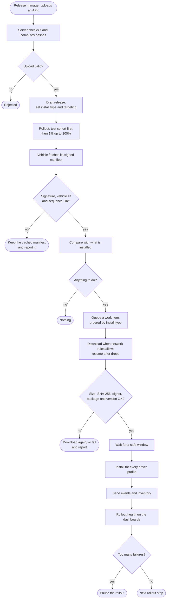

## 2. Choosing a network

How the store decides whether a download may use the current network. This covers S1 (Wi-Fi only)
and S2 (cellular). A phone hotspot counts as metered, the same as cellular.

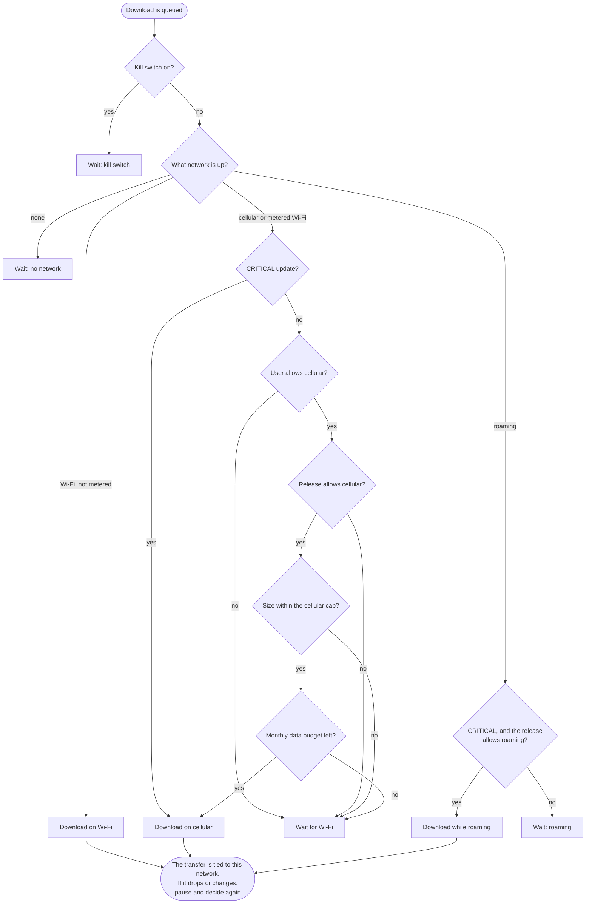

## 3. Download, drops and resume

What the downloader does with each server response. This covers S3 (intermittent network) and S4
(resume). Losing the network is a pause, never a failure.

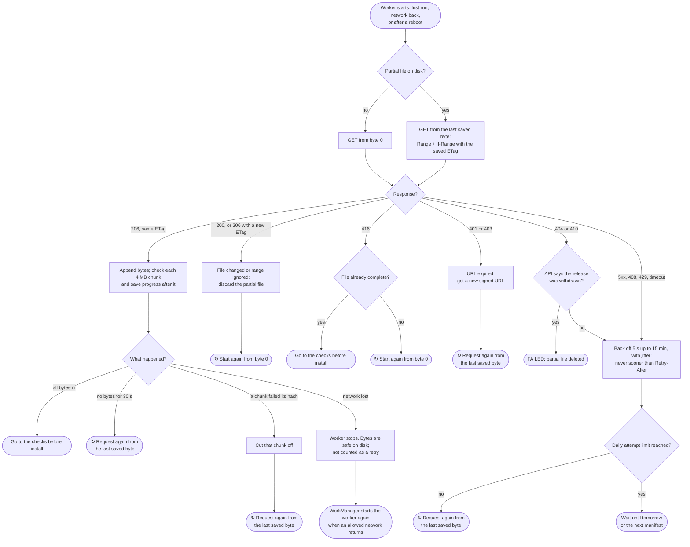

## 4. Checks before install

Nothing is installed until every check passes. This covers S5 (checksum validation).

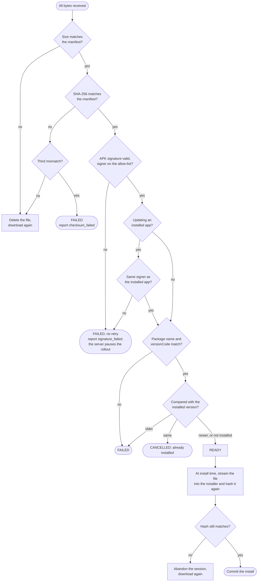

## 5. Install types at a glance

What `MANUAL`, `FORCED` and `CRITICAL` mean for one release on one vehicle.

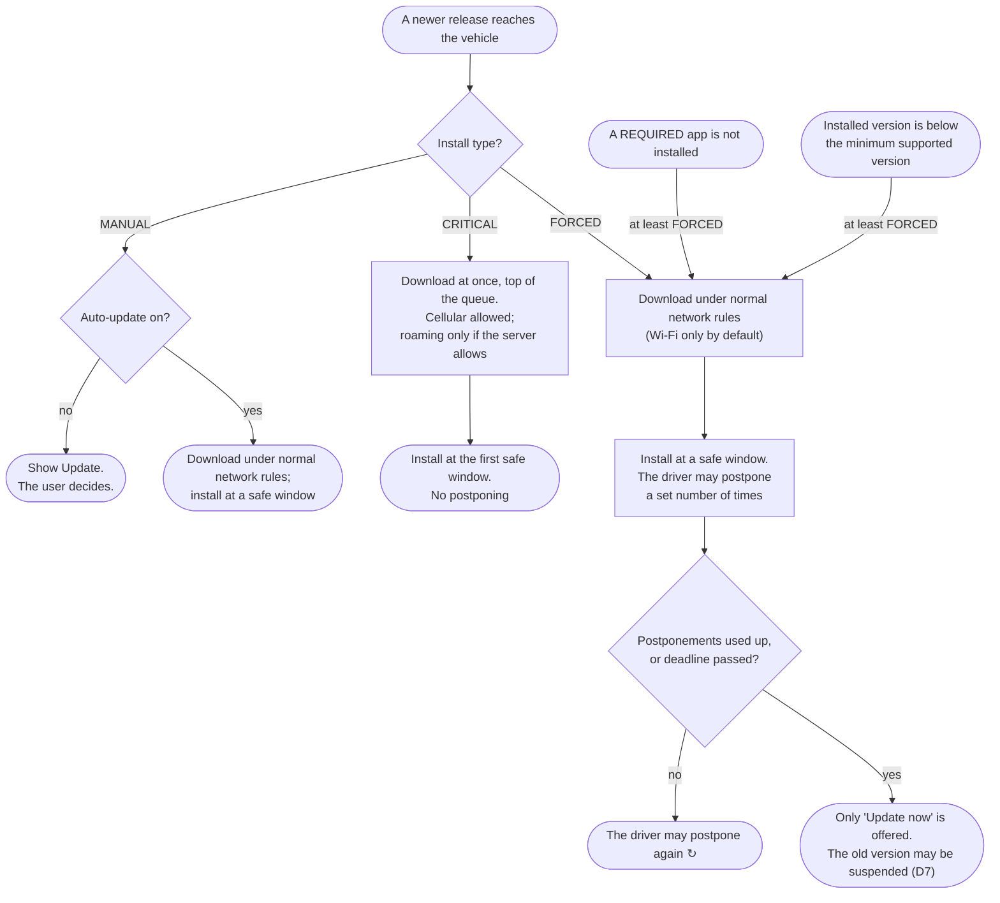

## 6. Install

**When an install may run.** "Automatic" means an auto-update of a manual release, a `FORCED`
release or a `CRITICAL` release.

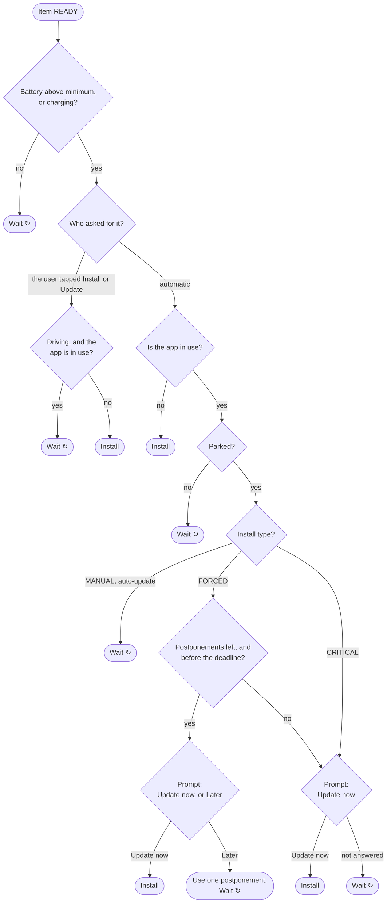

**What an install does.**

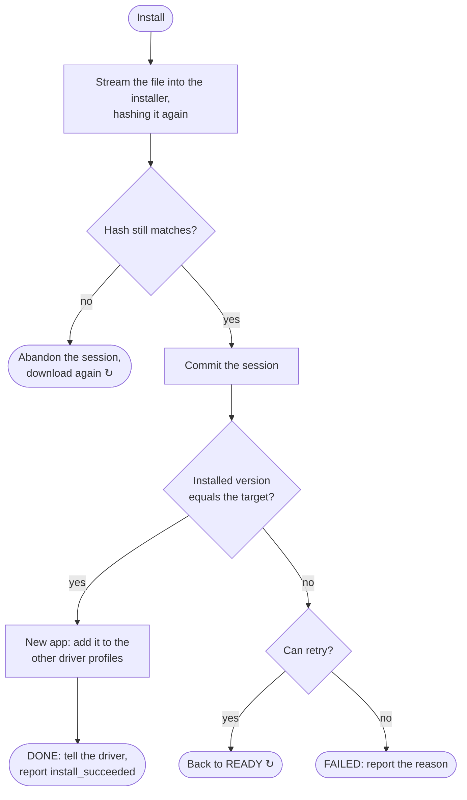

## 7. Uninstall

The user and the server start an uninstall differently, but both end the same way.

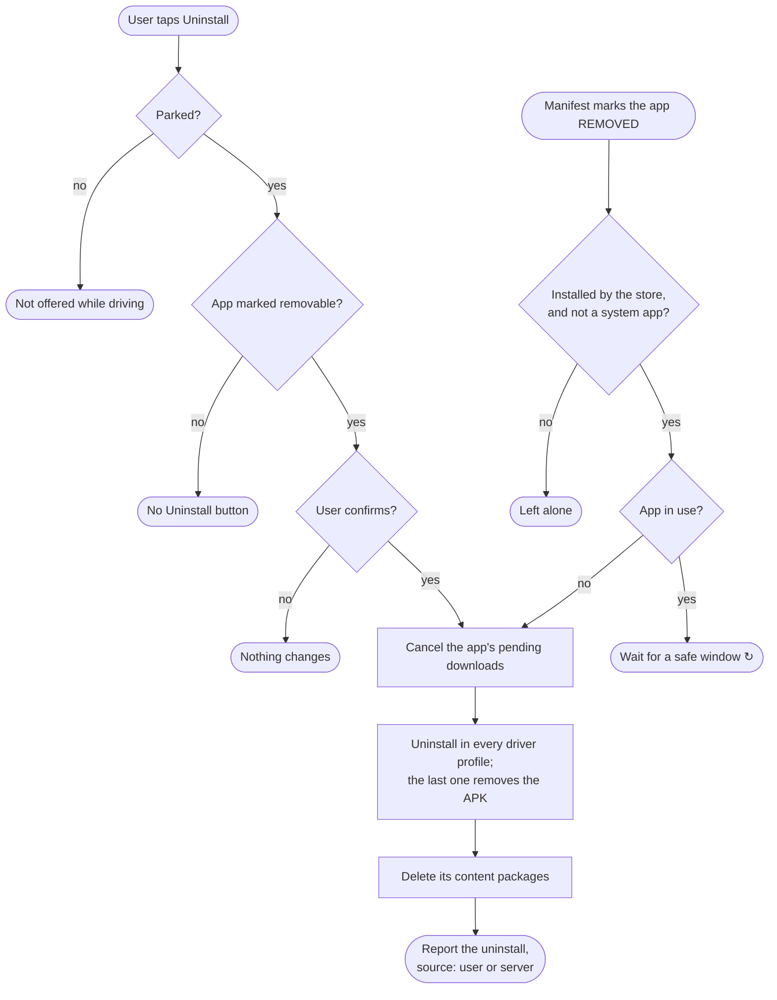

## 8. Content download

Maps, voice packs and other data an app needs outside its APK.

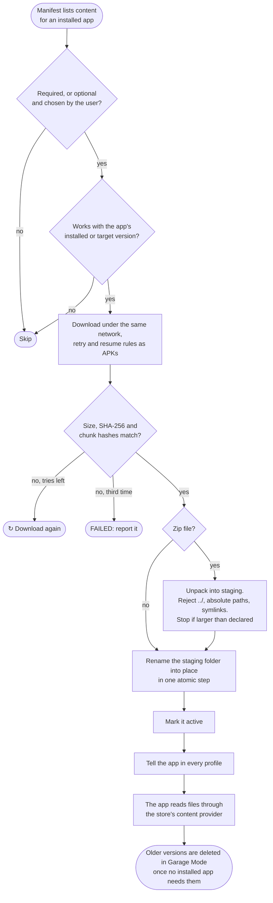

## 9. Analytics

From something happening in the car to a number on a dashboard.

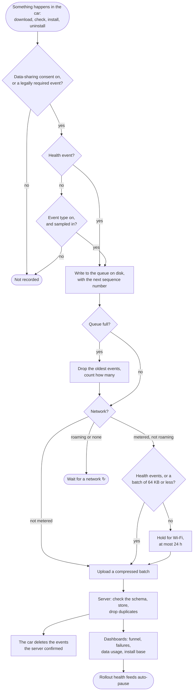

## 10. Publishing

How a new version gets into the system. This covers version management. Every step is written to
the audit log.

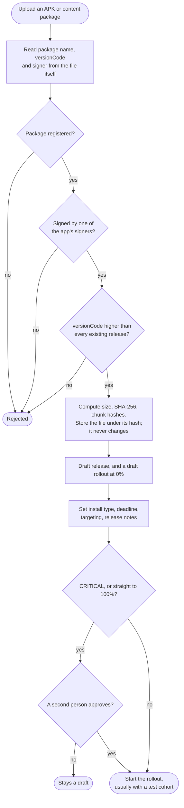

## 11. Phased rollout

How a running rollout grows, pauses itself, or is stopped. The rollout controller runs this every
5 minutes.

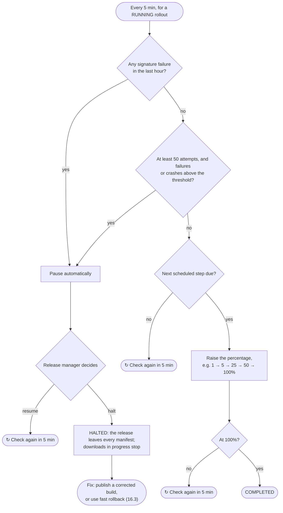

## 12. Which release a vehicle gets

What the server decides for each app each time a vehicle asks for its manifest. A vehicle's bucket is
a number from 0 to 9999, made from a hash of its ID and the app's package name. It never changes,
so a vehicle stays in a rollout once it is in. When no older release is left, the app gets nothing
new. The finished manifest is signed and sent to the vehicle.

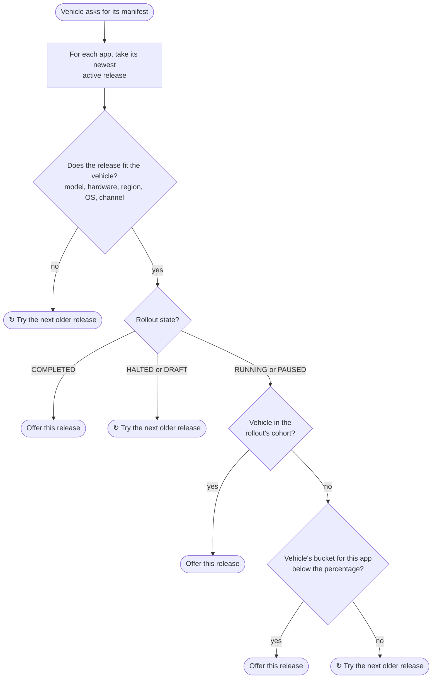
