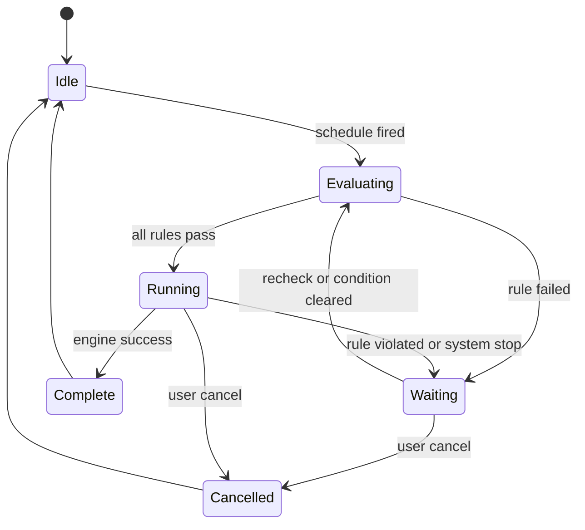
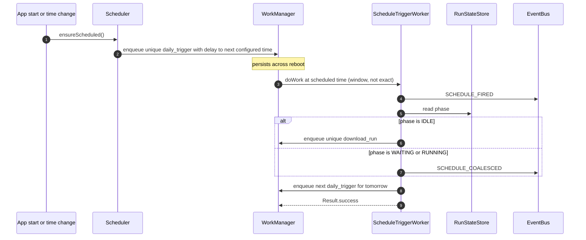
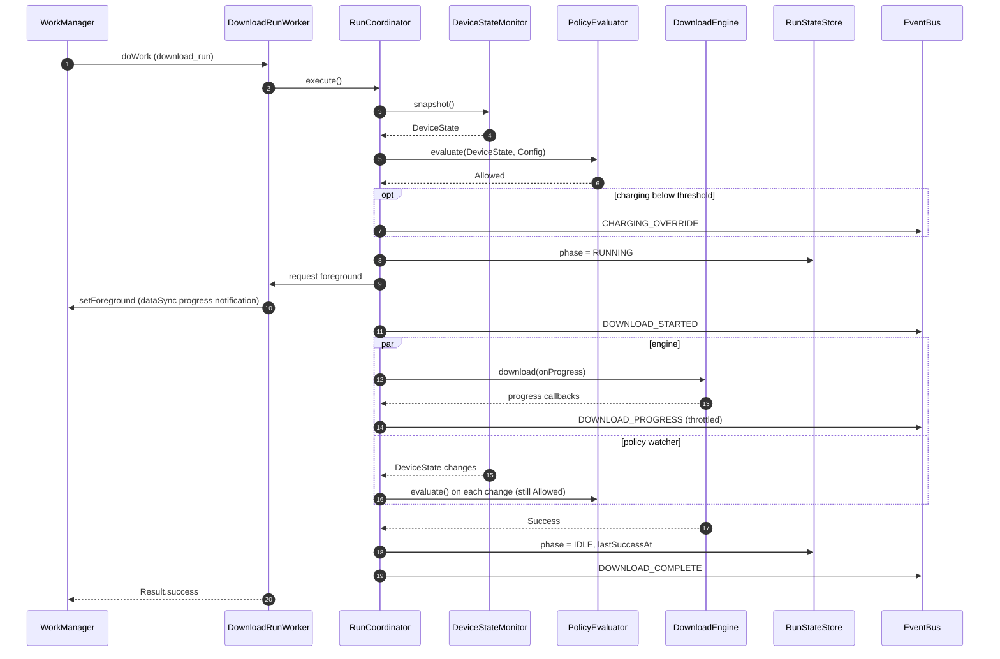
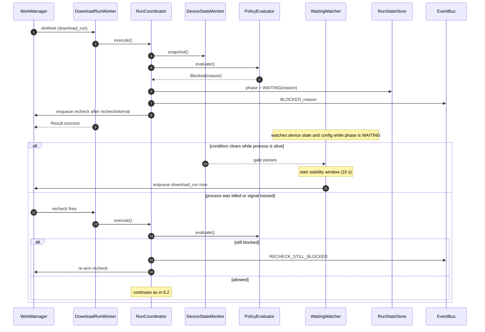
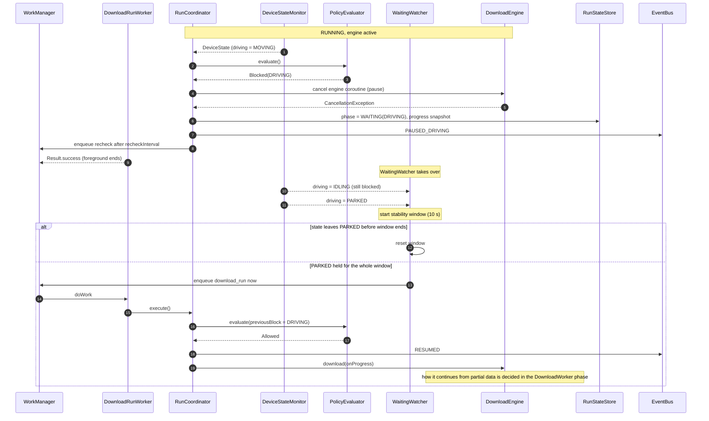
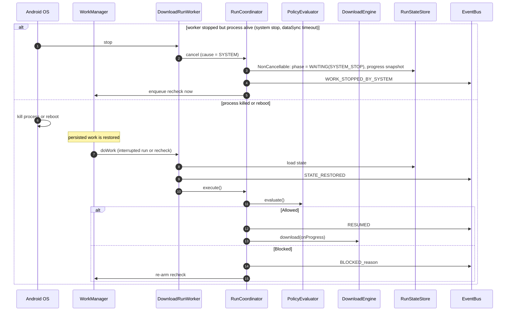
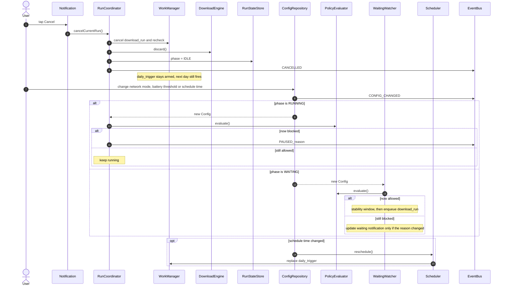

# Android Download Service: Requirements and Sequence Diagrams (v3)

Status: draft v3 for review. Hand to Claude desktop to build once approved.

Changes in v3: "safely parked" is now defined from vehicle signals (gear and speed), location is explicitly not used, and network handling now separates unmetered Wi-Fi, metered Wi-Fi hotspots, Bluetooth tethering and built-in cellular.

## 0. Scope note (read first)

**The DownloadWorker internals are out of scope for this phase.**

- In this phase the download itself is a black box called `DownloadEngine`. By default we assume it works: it either finishes with success or it is cancelled. There are no failure, retry, integrity, server-capability or resume-validation cases in this phase.
- **NOTE: when the DownloadWorker is implemented, we will improvise and add more cases.** Section 12 lists what is already known, but expect it to grow once real downloads are running.
- This phase builds everything around the engine: scheduling, the policy gate (driving, battery, network), device monitors, the driving-state provider, configuration, run-state persistence, wait and resume orchestration, events, notifications and logging.
- Build and test with a `FakeDownloadEngine` (section 4.3) so the whole shell works end to end before any real download code exists.

## 1. Scope

| In scope (this phase) | Deferred (DownloadWorker phase, see section 12) |
|-----------------------|-------------------------------------------------|
| Daily scheduling and re-arming | HTTP download, streaming, progress source |
| Policy gate: driving, battery, network | Server capability probe (Range, ETag, size, checksum) |
| Mid-run enforcement: pause and resume | Partial-file handling and resume validation |
| Device monitors and driving-state provider | Integrity verification |
| Config repository and live config changes | Retry, backoff and failure handling |
| Run-state persistence across reboot and process death | Storage-space rule |
| Events, notifications, logging, debug toasts | Update detection ("already up to date") |
| User cancel from notification | Failure notifications |

## 2. Confirmed inputs and assumptions

| # | Item | Decision | Status |
|---|------|----------|--------|
| A1 | File size | Over 500 MB, so a foreground worker (`dataSync`) is needed | Confirmed |
| A2 | Server contract | No guarantees. Handled in the DownloadWorker phase | Confirmed, deferred |
| A3 | Logging | Plain `Log` output, plus a Toast in debug builds. No file logging | Confirmed |
| A4 | Platform | Android Automotive OS (AAOS) head unit | Assumed |
| A5 | Driving rule | "Safely parked" means gear in Park and speed zero (section 5.1). Only `PARKED` allows download. `IDLING`, `MOVING` and `UNKNOWN` block or pause | Goal confirmed, signals assumed |
| A6 | Battery | 20 percent threshold, configurable. After a battery wait, resume only at threshold plus 5 points (or when charging) to avoid flapping | Assumed |
| A7 | Schedule | Daily at a configured time. A one-time WorkManager request with a computed delay, re-armed after each trigger | Assumed |
| A8 | Network | Classified by transport and metered flag (section 5.2). Tethering (phone hotspot, Bluetooth) is excluded by default. Ethernet is not allowed | Assumed |
| A9 | Resume stability | Conditions must hold for 10 seconds before a start or resume after a wait | Assumed |
| A10 | Engine contract | The engine ends only in success or cancellation in this phase | Confirmed |
| A11 | Location | Not used by any rule. Parking is decided from vehicle signals, which are more reliable and avoid collecting location (privacy). A saved-places rule is a possible later option (section 14) | Confirmed |

Note on A4: an earlier draft recommended `CarDrivingStateManager`. In AOSP car-lib that class is a system API, so a normal app may not be allowed to use it. The `DrivingStateProvider` interface hides this choice. On the target build, confirm which of these the app may use: `CarDrivingStateManager` (needs `CAR_DRIVING_STATE`), or the public alternatives `CarPropertyManager` (gear selection, parking brake, speed) and `CarUxRestrictionsManager`.

## 3. Functional requirements (in scope)

### Scheduling

- FR-1. Run once a day at a configured time. Use a one-time WorkManager request with an initial delay to the next occurrence, and enqueue the next one each time the trigger fires. This is a window, not an exact time, because Doze can delay work. Exact alarms are an optional later add-on.
- FR-2. WorkManager persists the schedule across reboot. `Scheduler.ensureScheduled()` is also called at app start and on time or time-zone change to repair the schedule.
- FR-3. Two kinds of work, both with unique names:
  - `daily_trigger` (small, no foreground): fires at the scheduled time, decides whether to start a run, re-arms tomorrow's trigger.
  - `download_run` (foreground when the engine is running): does the policy gate and runs the engine.
- FR-4. Only one run at a time. If the trigger fires while a run is already `WAITING` or `RUNNING`, coalesce: do not start a second run, log `SCHEDULE_COALESCED`.
- FR-5. If the device was off at the scheduled time, WorkManager runs the trigger when the device returns. That is acceptable.

### Policy gate

- FR-6. `PolicyEvaluator` is a pure function: `evaluate(DeviceState, Config, previousBlock)` returns `Allowed(chargingOverride)` or `Blocked(reason, detail)`. Rules run in order: driving, battery, network. It reports the first failing rule. In debug builds it also logs all failing rules.
- FR-7. Driving: allowed only when `PARKED` (gear in Park and speed zero, see section 5.1). `IDLING`, `MOVING` and `UNKNOWN` are blocked (fail safe).
- FR-8. Battery: allowed when charging, or when level is at or above the threshold. Charging below the threshold is allowed and logs `CHARGING_OVERRIDE` once per run. If the previous block was `BATTERY`, the level must be at or above threshold plus the resume margin (unless charging).
- FR-9. Network: classify the active network (section 5.2). `WIFI_ONLY` allows validated unmetered Wi-Fi. `WIFI_OR_CELLULAR` allows validated unmetered Wi-Fi or the vehicle's own cellular. Metered Wi-Fi (typically a phone hotspot) and Bluetooth tethering are blocked unless `allowTethered` is on. Everything else is blocked.
- FR-10. Start immediately if the gate passes at the scheduled trigger. After any wait (blocked at start or paused mid-run), the gate must pass continuously for `resumeStabilityWindow` (10 s) before the run starts or resumes. A pause itself is immediate.

### Mid-run enforcement

- FR-11. While `RUNNING`, `RunCoordinator` collects `DeviceStateMonitor.state` and `ConfigRepository.config`, and re-evaluates the policy on every change.
- FR-12. On a violation: cancel the engine's coroutine (this is the pause), persist `WAITING(reason)` plus the last progress snapshot, emit `PAUSED_<reason>`, post the paused notification, arm the recheck, and end the worker with success. The foreground notification goes away when the worker ends.
- FR-13. Resume: when the gate has passed for the stability window, enqueue `download_run` immediately. The new run re-evaluates the policy, emits `RESUMED` (or `DOWNLOAD_STARTED` if nothing was started before) and calls the engine again. How the engine continues from partial data is the engine's business (deferred).
- FR-14. Config changes apply immediately. While `RUNNING`, the coordinator re-evaluates and pauses or continues. While `WAITING`, the watcher re-evaluates and may start the stability window. If the schedule time changes, replace `daily_trigger`. Always log `CONFIG_CHANGED`.

### Waiting and wake-up

- FR-15. While `WAITING`, two mechanisms wake the run:
  - **WaitingWatcher** (in process): observes the device state and config flows and enqueues `download_run` as soon as the gate has held for the stability window.
  - **Recheck work** (persisted): a delayed `download_run` every `recheckInterval` (15 min) as a safety net if the process was killed or a signal was missed.
- FR-16. A recheck that finds the same block reason logs `RECHECK_STILL_BLOCKED` (log only, no new notification) and re-arms itself.
- FR-17. Notifications are posted only when the state or the reason changes, and update in place.

### System stop, reboot, process death

- FR-18. If WorkManager stops the worker (system stop, Android 15 `dataSync` timeout, constraint change), the coordinator must in a `NonCancellable` block: persist `WAITING(SYSTEM_STOP)` with the progress snapshot, emit `WORK_STOPPED_BY_SYSTEM`, and enqueue an immediate recheck. The coordinator distinguishes three cancel causes: policy pause, user cancel, system stop.
- FR-19. After a reboot or process kill, WorkManager restores persisted work. The worker loads `RunStateStore`, emits `STATE_RESTORED`, re-runs the policy gate, and then resumes or goes back to waiting.

### Foreground behavior

- FR-20. Call `setForeground` (type `dataSync`) only when the engine is about to start. A run that is blocked at the gate never shows a foreground notification, only the waiting notification.
- FR-21. Use distinct notification IDs: one for the foreground progress notification, one for the status (waiting or paused) notification. This avoids the foreground notification being removed together with a paused message.

### User cancel

- FR-22. The ongoing and waiting notifications have a Cancel action. Cancel stops only the current run: cancel `download_run` and recheck work, call `engine.discard()`, set state to `IDLE`, emit `CANCELLED`, clear notifications. `daily_trigger` stays armed, so the next day still fires.

### Completion

- FR-23. When the engine returns `Success`: set state `IDLE` with `lastSuccessAt`, emit `DOWNLOAD_COMPLETE`, post the completion notification, and make sure tomorrow's `daily_trigger` exists.

### Persistence

- FR-24. `RunStateStore` (DataStore) persists: `runId`, `state`, `waitReason`, `hasStarted`, last progress snapshot (`downloaded`, `total` nullable), `lastNotifiedReason`, `lastStateChangeAt`, `lastSuccessAt`.

### Notifications and logging

- FR-25. Every state change goes through `EventBus.emit(event)`, which fans out to `Logger` and `NotificationController`. This guarantees a log and (where listed) a notification for each case.
- FR-26. Log format, tag `DlService`: `[runId] EVENT | batt=NN% chg=Y/N net=UNMETERED_WIFI drv=PARKED bytes=A/B | message`.
- FR-27. In debug builds (`BuildConfig.DEBUG`), also show a Toast for each event, posted on the main looper, except `DOWNLOAD_PROGRESS` and `DEVICE_STATE_CHANGED` (log only, to avoid toast storms). Release builds never show Toasts.

## 4. Component contracts

### 4.1 Data model

```kotlin
enum class DrivingState { PARKED, IDLING, MOVING, UNKNOWN }
enum class NetworkTransport { NONE, WIFI, CELLULAR, BLUETOOTH, ETHERNET, OTHER }
enum class NetworkClass { NONE, UNMETERED_WIFI, METERED_WIFI, CELLULAR, BLUETOOTH_TETHER, ETHERNET, OTHER }
enum class NetworkMode { WIFI_ONLY, WIFI_OR_CELLULAR }
enum class BlockReason { DRIVING, BATTERY, NETWORK, SYSTEM_STOP }   // STORAGE added in the DownloadWorker phase

data class BatteryState(val levelPercent: Int, val charging: Boolean)
data class NetworkState(val transport: NetworkTransport, val metered: Boolean, val validated: Boolean)
data class DeviceState(val battery: BatteryState, val network: NetworkState, val driving: DrivingState)

data class Config(
    val scheduleTime: LocalTime = LocalTime.of(2, 0),   // placeholder default for testing
    val networkMode: NetworkMode = NetworkMode.WIFI_ONLY,
    val allowTethered: Boolean = false,                  // metered Wi-Fi hotspots and Bluetooth tethering
    val requireParkingBrake: Boolean = false,            // extra condition for PARKED
    val batteryThresholdPercent: Int = 20,
    val batteryResumeMarginPercent: Int = 5,
    val resumeStabilityWindow: Duration = 10.seconds,
    val recheckInterval: Duration = 15.minutes,
)

sealed interface PolicyDecision {
    data class Allowed(val chargingOverride: Boolean) : PolicyDecision
    data class Blocked(val reason: BlockReason, val detail: String) : PolicyDecision
}

enum class RunPhase { IDLE, RUNNING, WAITING }   // Evaluating, Complete and Cancelled are transient
```

### 4.2 Main interfaces

```kotlin
interface PolicyEvaluator {
    fun evaluate(state: DeviceState, config: Config, previousBlock: BlockReason? = null): PolicyDecision
}

interface DeviceStateMonitor {
    val state: Flow<DeviceState>        // combined, conflated
    suspend fun snapshot(): DeviceState // one-shot read for the gate
}

interface DrivingStateProvider { val driving: Flow<DrivingState> }  // AAOS impl now, phone impl later

interface ConfigRepository { val config: Flow<Config>; suspend fun update(transform: (Config) -> Config) }

interface EventBus { fun emit(event: ServiceEvent) }
```

### 4.3 Download engine contract (frozen for this phase)

```kotlin
interface DownloadEngine {
    /** Runs until done. Cancelling the calling coroutine means "pause". */
    suspend fun download(onProgress: (downloaded: Long, total: Long?) -> Unit): DownloadResult
    /** Called on user cancel. The engine decides what to clean up. */
    suspend fun discard()
}

sealed interface DownloadResult {
    data object Success : DownloadResult
    // Failure variants are added in the DownloadWorker phase
}
```

`FakeDownloadEngine`: simulates a 600 MB download at a configurable speed (default about 2 minutes total). It remembers its simulated offset across cancellations, so pause and resume are visible in the logs.

## 5. Policy rules (evaluated in this order)

| # | Rule | Allowed when | Wake-up signal while waiting |
|---|------|--------------|------------------------------|
| 1 | Driving | `PARKED`: gear in Park and speed zero (section 5.1) | Gear or speed change |
| 2 | Battery | Charging, or level at or above threshold (threshold plus margin after a battery wait) | Battery level or plug change |
| 3 | Network | Allowed class for the mode, and validated (section 5.2) | Connectivity callback |
| 4 | Storage | Deferred to the DownloadWorker phase | n/a |

Driving is first because it is a safety rule and the cheapest to evaluate.

### 5.1 Safely parked (driving signal)

`DrivingStateProvider` maps vehicle signals to `DrivingState`:

| State | Condition |
|-------|-----------|
| `PARKED` | Gear is Park AND speed is zero (small noise tolerance) AND, if `requireParkingBrake` is on, the parking brake is engaged |
| `IDLING` | Speed is zero but gear is not Park (for example Drive at a red light, or Neutral) |
| `MOVING` | Speed above zero |
| `UNKNOWN` | A required signal is unavailable or stale |

Both gear and speed are required: speed alone cannot tell a red light from a parked car, and gear alone does not prove the car has stopped. Resume still uses the 10 s stability window. Signal source on the target build: `CarPropertyManager` properties for gear selection, vehicle speed and parking brake, or `CarDrivingStateManager` if the app is allowed to use it (see the A4 note). Location is not used (A11).

### 5.2 Network classification (Wi-Fi vs tethering)

`NetworkClassifier.classify(NetworkState): NetworkClass` is a pure function. All allowed classes also require `validated` (the system has confirmed internet access).

| Class | Detected as | `WIFI_ONLY` | `WIFI_OR_CELLULAR` |
|-------|-------------|-------------|--------------------|
| `UNMETERED_WIFI` | Transport Wi-Fi, not metered | Allowed | Allowed |
| `METERED_WIFI` | Transport Wi-Fi, metered (usually a phone hotspot) | Blocked unless `allowTethered` | Blocked unless `allowTethered` |
| `CELLULAR` | Transport cellular (the vehicle's own modem) | Blocked | Allowed |
| `BLUETOOTH_TETHER` | Transport Bluetooth (PAN tethering) | Blocked unless `allowTethered` | Blocked unless `allowTethered` |
| `ETHERNET`, `OTHER`, `NONE` | Anything else | Blocked | Blocked |

How tethering is told apart, and the limits:

- The best signal is the Android metered flag (the network lacks `NET_CAPABILITY_NOT_METERED`). Android phones usually advertise their hotspot as metered to connected devices. Bluetooth tethering is easy to spot because it arrives as its own transport.
- There is no API that says "this Wi-Fi is a hotspot." Some hotspots (a standalone mobile router, some phones) may not be flagged and can look like normal Wi-Fi. The user can also mark any network as metered or unmetered in system settings. The flag really measures cost, which is what the rule cares about, so a Wi-Fi network backed by a home 5G gateway that reports unmetered is treated as normal Wi-Fi.
- Not used: guessing from the network name (SSID) or gateway address. It is brittle, and reading the SSID needs a location-related permission, which conflicts with A11.
- On AAOS, the vehicle's built-in connectivity may be exposed with OEM network capabilities (`OEM_PAID`, `OEM_PRIVATE`) instead of plain cellular. `NetworkMonitor` must map it to `CELLULAR`. Confirm on the target build.

## 6. State machine



A `Failed` state is reserved for the DownloadWorker phase. `Waiting` always carries a reason.

## 7. Event, notification and log catalog

| Event | Notification | Log |
|-------|--------------|-----|
| SCHEDULE_FIRED | none | I |
| SCHEDULE_COALESCED | none | I |
| BLOCKED_DRIVING | "Download waiting: vehicle must be parked" | I |
| BLOCKED_BATTERY | "Download waiting: charge or battery above N%" | I |
| BLOCKED_NETWORK | "Download waiting for unmetered Wi-Fi" or "Waiting for Wi-Fi or cellular (tethering not allowed)" | I |
| CHARGING_OVERRIDE | none | I |
| DOWNLOAD_STARTED | ongoing progress (foreground) | I |
| DOWNLOAD_PROGRESS | progress update, throttled to 1 per second | D |
| PAUSED_DRIVING | "Download paused: vehicle moving" | I |
| PAUSED_BATTERY | "Download paused: low battery" | I |
| PAUSED_NETWORK | "Download paused: network not allowed" | I |
| RESUMED | ongoing progress (foreground) | I |
| RECHECK_STILL_BLOCKED | none | D |
| WORK_STOPPED_BY_SYSTEM | none | W |
| STATE_RESTORED | none | I |
| CONFIG_CHANGED | none | I |
| DEVICE_STATE_CHANGED | none | D |
| DOWNLOAD_COMPLETE | "Download complete" | I |
| CANCELLED | clears notifications | I |

Notification channels: `download_status` (low importance, silent) for everything in this phase. `download_alerts` (default importance) is reserved for failures in the DownloadWorker phase. Notifications while driving must never be attention-grabbing.

## 8. Sequence diagrams

Participants: `Sch` Scheduler, `WM` WorkManager, `T` ScheduleTriggerWorker, `W` DownloadRunWorker, `RC` RunCoordinator, `P` PolicyEvaluator, `Mon` DeviceStateMonitor, `WA` WaitingWatcher, `DE` DownloadEngine (assumed to succeed), `St` RunStateStore, `CFG` ConfigRepository, `E` EventBus (logs, notifications, debug toasts).

### 8.1 Scheduling lifecycle



### 8.2 Scheduled run, happy path



### 8.3 Blocked at start, waiting, then wake-up



### 8.4 Mid-run violation, pause and resume



Battery and network pauses follow the same flow with `PAUSED_BATTERY` or `PAUSED_NETWORK`. For battery, `previousBlock = BATTERY` makes the evaluator require threshold plus margin before resuming.

### 8.5 System stop, reboot, process death



### 8.6 User cancel and config change



## 9. Class breakdown

| Class | Responsibility |
|-------|----------------|
| `Scheduler` | `ensureScheduled()`, `reschedule()`, enqueue and re-arm `daily_trigger` and recheck |
| `ScheduleTriggerWorker` | Fires at the scheduled time, coalesces or enqueues the run, re-arms tomorrow |
| `DownloadRunWorker` (`CoroutineWorker`) | Thin shell: calls the coordinator, provides foreground info, maps outcome to `Result` |
| `RunCoordinator` | Orchestrates gate, engine job, pause and resume, cancel causes, state persistence |
| `PolicyEvaluator` | Pure rule evaluation (section 5) |
| `DeviceStateMonitor` | Combines battery, network and driving flows, plus `snapshot()` |
| `BatteryMonitor` | Battery level and charging. See the battery question in section 13 |
| `NetworkMonitor` | `ConnectivityManager` callback. Reads transport, metered and validated flags, and maps OEM networks to cellular |
| `NetworkClassifier` | Pure function from `NetworkState` to `NetworkClass` (section 5.2) |
| `DrivingStateProvider` | Maps gear, speed and optional parking brake to `DrivingState` (section 5.1). Vehicle-signal implementation now, a phone implementation only if ever needed |
| `WaitingWatcher` | In-process observer while `WAITING`, applies the stability window, enqueues the run |
| `ConfigRepository` | DataStore-backed `Config` with a `Flow` |
| `RunStateStore` | DataStore-backed run state (FR-24) |
| `EventBus`, `Logger` | Single `emit(event)` fan-out. `Logger` wraps `android.util.Log` plus debug Toast |
| `NotificationController` | Channels, foreground progress, status notification, Cancel action |
| `CancelReceiver` | Handles the Cancel action and calls `cancelCurrentRun()` |
| `DownloadEngine` | Interface (section 4.3). `FakeDownloadEngine` now, real engine later |
| `Clock` | Injected time source for tests |

Suggested packages: `scheduling/`, `policy/`, `monitor/`, `run/`, `events/`, `config/`, `engine/`.

## 10. Non-functional requirements

- NFR-1. Permissions: `POST_NOTIFICATIONS` (Android 13+), `FOREGROUND_SERVICE`, `FOREGROUND_SERVICE_DATA_SYNC` (Android 14+), `ACCESS_NETWORK_STATE`, and the car driving-state permission (confirm grant level on the target build).
- NFR-2. Monitors register their callbacks only while needed (`RUNNING` or `WAITING`) and unregister in a `finally` block. No leaks.
- NFR-3. Policy evaluation is cheap and runs off the main thread. State flows are conflated, so bursts of events do not queue up.
- NFR-4. Android 15 limits `dataSync` foreground time (about 6 hours per day). The system-stop path (FR-18) must handle its timeout.
- NFR-5. Testability: `PolicyEvaluator` is pure. Monitors, provider, config, store and clock are behind interfaces with fakes.

## 11. Acceptance test cases (using `FakeDownloadEngine`)

1. Scheduled trigger with all rules passing: run starts, progress is logged, `DOWNLOAD_COMPLETE` is emitted, tomorrow's trigger is armed.
2. Trigger while `MOVING`: no foreground notification, "waiting" notification, run starts only after `PARKED` holds for 10 s.
3. Driving flaps `PARKED`, `IDLING`, `PARKED` within 10 s: no start, window resets.
4. Battery 15 percent unplugged: blocked. Plug in: starts, `CHARGING_OVERRIDE` logged once.
5. Battery 22 percent after a battery wait: still blocked (needs 25 percent). At 25 percent: resumes.
6. Wi-Fi only config with cellular only: blocked. Wi-Fi returns: starts.
7. `MOVING` mid-run: engine cancelled, state `WAITING(DRIVING)`, silent paused notification. After `PARKED` 10 s: `RESUMED`.
8. Battery drops below threshold mid-run while unplugged: paused. Charger connected: resumed.
9. Wi-Fi lost mid-run: paused. Wi-Fi back: resumed.
10. Driving state `UNKNOWN`: treated as blocked.
11. Config change from `WIFI_ONLY` to `WIFI_OR_CELLULAR` while waiting on cellular: starts after the stability window.
12. Config change that makes a running download violate the policy: pauses.
13. Schedule fires while a run is `WAITING`: `SCHEDULE_COALESCED`, no second run.
14. Process killed mid-run: WorkManager restores the work, `STATE_RESTORED`, policy re-run, resume or wait.
15. System stop of the worker: `WORK_STOPPED_BY_SYSTEM`, immediate recheck, resume when allowed.
16. Cancel from the notification: state `IDLE`, notifications cleared, next day's trigger still fires.
17. Recheck with the same block reason: log only, no repeated notification.
18. Release build: no Toasts. Debug build: Toast per event except progress and device-state changes.
19. Gear shifts from Park to Drive at speed zero: state `IDLING`, run pauses. Back in Park with speed zero for 10 s: resumes.
20. Gear is Park but the speed signal is unavailable: `UNKNOWN`, blocked.
21. `requireParkingBrake` on, gear Park, brake released: blocked. Brake engaged: allowed.
22. Phone hotspot (Wi-Fi, metered) in `WIFI_ONLY` mode: blocked with the "tethering not allowed" message. Real unmetered Wi-Fi: starts.
23. Bluetooth tethering in `WIFI_OR_CELLULAR` mode: blocked. With `allowTethered` on: allowed.
24. Vehicle cellular exposed as an OEM network: classified as `CELLULAR` and allowed in `WIFI_OR_CELLULAR`.

## 12. Deferred to the DownloadWorker phase

**NOTE: when the DownloadWorker is implemented we will improvise and add more cases. This list is the known starting point, not the full set.**

- HTTP streaming on `Dispatchers.IO`, `.part` file, atomic rename, progress source.
- Server capability probe: HEAD (or Range probe fallback) for Content-Length, Accept-Ranges, ETag, Last-Modified, checksum header. The server contract is unknown, so everything is optional.
- Resume: `Range` with `If-Range`, accept only 206 with a matching `Content-Range`, restart on mismatch (`RESTARTED_FROM_ZERO` event).
- Servers without Range support: soft pause (hold the connection for a limited time) or restart from zero.
- Integrity: length check, optional checksum header, optional file-type sanity check (valid APK or ZIP). One retry from scratch on failure.
- Retry policy: 5 retries, exponential backoff from 30 s capped at 15 min. 5xx, timeouts and resets are retried. 401, 403 and 404 fail immediately.
- Failure handling: `DOWNLOAD_FAILED`, `RETRY_SCHEDULED`, `VERIFY_FAILED` events, the `download_alerts` channel, a `Failed` state.
- Storage rule: block when free space is below the expected size plus margin (needs the size from the probe), `BLOCKED_STORAGE` event.
- Update detection: skip the download when the server version matches the stored one.
- Persisted engine data: byte offset, validators, target file.

How the shell will change when that phase lands:

- `DownloadResult` gains failure variants. `RunCoordinator` maps them to retry, wait or failed.
- `BlockReason` gains `STORAGE`, and `PolicyEvaluator` gets a fourth rule.
- `RunStateStore` gains the engine's partial-download data.
- The engine's own cancellation behavior decides how pause and resume behave for the file. The shell already treats cancellation as pause.

## 13. Confirmations (defaults apply unless you change them)

1. Platform is an AAOS head unit (A4). If it is a phone, only `DrivingStateProvider` changes.
2. Ethernet is not an allowed network (A8). Head units sometimes use it, so tell me if it should be allowed.
3. Pause mechanism: the worker ends on pause, with an in-process watcher and a 15-minute recheck for wake-up (FR-12, FR-15).
4. Stability window is 10 s and the battery resume margin is 5 points (A6, A9).
5. Tethering is blocked by default (`allowTethered` off). Turn it on only if phone-hotspot or Bluetooth data should count.
6. The parking brake is not required by default. Turn on `requireParkingBrake` if "safely parked" must include it.
7. Battery meaning: a vehicle head unit has no device battery to read. If this is an EV, I recommend the rule use the EV battery state of charge, with "charging" meaning the charge port is connected and charging. `BatteryMonitor` would then read vehicle properties (for example `EV_BATTERY_LEVEL` and `EV_CHARGE_PORT_CONNECTED` in car-lib, to be confirmed on the target build) instead of the Android `BatteryManager`. Tell me if you meant a different battery, such as the 12 V battery.

## 14. Future options (not in this phase)

- Saved-places rule: optional and off by default, for example "download only when parked at a saved place such as home." It would use on-device geofences, store only the result and never coordinates, and need an explicit opt-in. No coordinates in logs, Toasts, notifications or crash reports.
- Trusted networks list: let the user pick specific Wi-Fi networks as always allowed. Reading network names needs a location-related permission, so this is not recommended for the first version.
