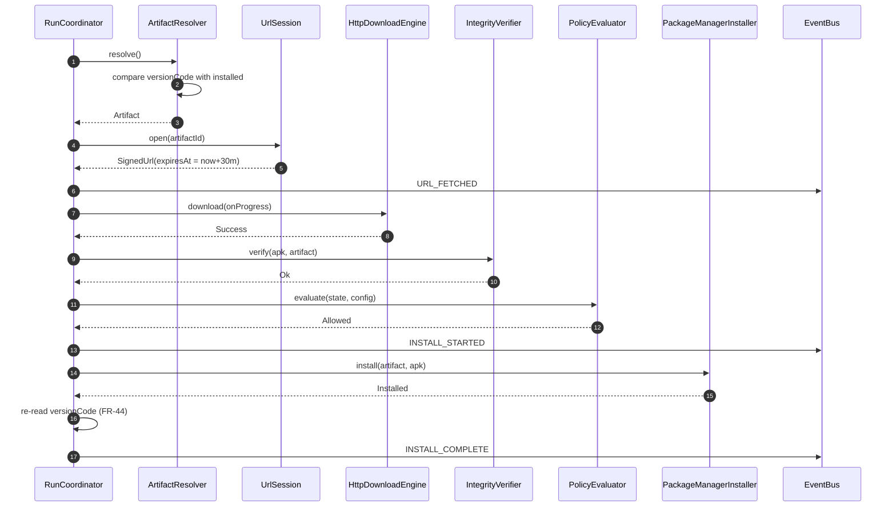
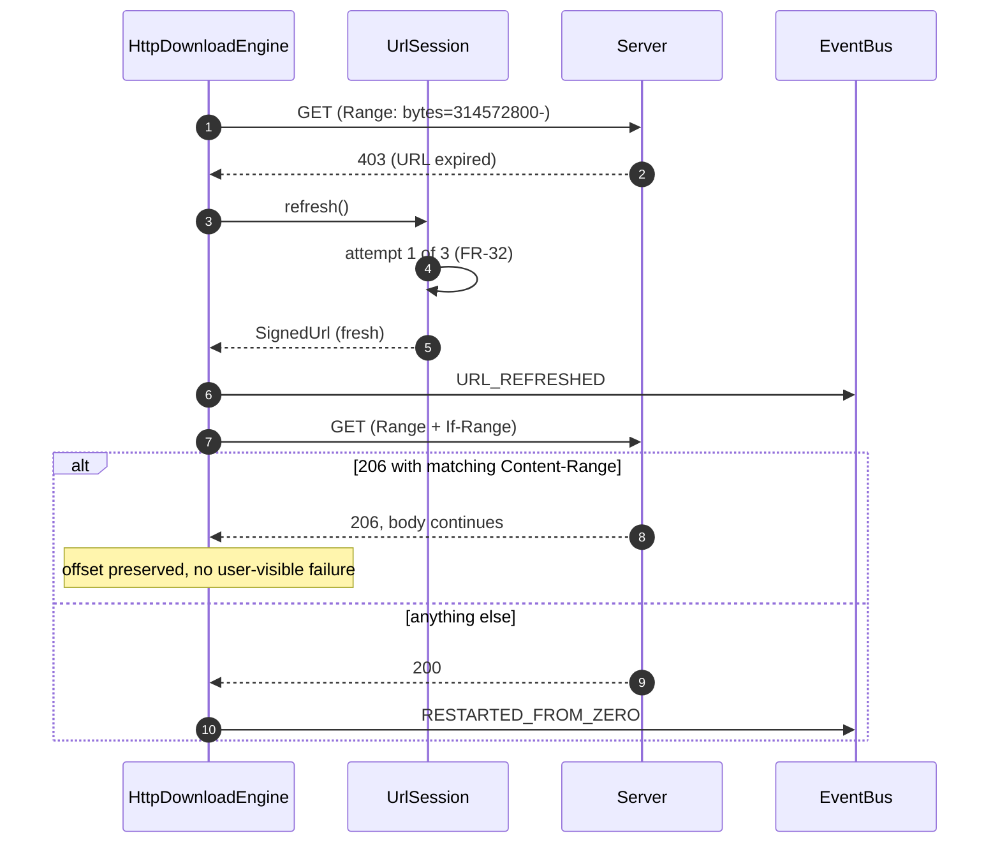
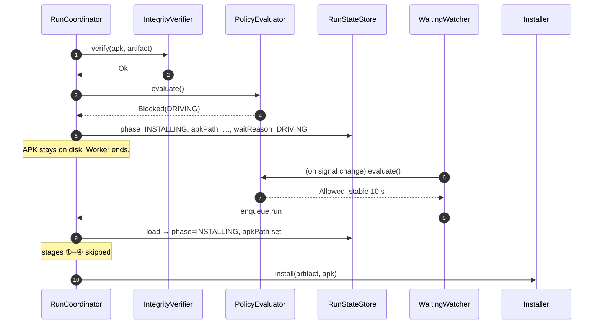

# Design v4 — artifact URLs, real transfer, install

Implements [requirements v4](../android-download-service-requirements-v4.md) (FR-28 … FR-57).
v3's shell — scheduler, policy gate, waiting watcher, events, notifications — keeps its shape.

---

## 1. Principles

1. **The frozen engine contract stays frozen.** v3 §4.3 defined `download(onProgress)` / `discard()`,
   cancellation means pause. The URL and its refresh are injected at *construction*, not threaded through
   the call, so the contract does not move (FR-34).
2. **`RunCoordinator` orchestrates; it does not grow new logic.** Each new stage is a collaborator it
   calls in order. The method is already long; this phase must not double it.
3. **One gate implementation.** Install reuses `PolicyEvaluator`, it does not get its own rules (FR-42).
4. **Debug code lives only in the debug source set, and `src/main` never names it** (FR-57). §10 is how.
5. **The device is the source of truth.** Install success is decided by re-reading `versionCode`, not by
   the installer's return value (FR-44) — the same rule the store already applies to its own list.

---

## 2. Package layout

```
com.lucid.appmanager
├── catalogue/          Artifact, Digest, SignedUrl, CatalogueProvider, ArtifactUrlProvider   [changed]
├── download/
│   ├── engine/         DownloadEngine (unchanged), HttpDownloadEngine, UrlSession            [new]
│   ├── verify/         IntegrityVerifier, VerifyResult                                       [new]
│   ├── policy/         + BlockReason.STORAGE, StorageRule                                    [changed]
│   ├── run/            RunCoordinator, RunState (+artifactId, +apkPath, +INSTALLING)         [changed]
│   └── config/         Flags (+installMode)                                                  [changed]
├── install/            Installer, InstallMode, InstallOutcome,                               [new]
│                       PackageManagerInstaller, OverrideStagingInstaller,
│                       PendingOverride, PendingOverrideStore
├── ipc/, ui/, signals/ unchanged except the AIDL additions in §11
└── (debug source set)
    └── debug/          DebugApplication, DebugFlagActions, DebugActionReceiver, fakes        [new]
```

---

## 3. The run pipeline

`RunCoordinator.execute()` gains four stages between "gate" and "complete". Everything it does today is
preserved; the new work is delegated.

```
          ┌─ gate (v3, unchanged) ─────────────────────────────┐
          │  policy.evaluate → Blocked ⇒ WAITING, return       │
          └────────────────────────────┬───────────────────────┘
                                       ▼
   ① ArtifactResolver.resolve()  → artifact, or UP_TO_DATE ⇒ complete      FR-28, FR-29
                                       ▼
   ② UrlSession.open(artifactId) → first SignedUrl (lazy, here and nowhere earlier)  FR-30
                                       ▼
   ③ engineFactory(request).download(onProgress)   ← v3 loop, unchanged     FR-34…FR-37
                                       ▼
   ④ IntegrityVerifier.verify()  → ok | fail ⇒ one retry, else FAILED       FR-39…FR-41
                                       ▼
          ┌─ gate again (same evaluator) ──────────────────────┐
          │  Blocked ⇒ WAITING(reason), APK kept on disk       │           FR-42
          └────────────────────────────┬───────────────────────┘
                                       ▼
   ⑤ Installer.install(artifact, apk) → Installed | Staged | Failed         FR-43…FR-51
                                       ▼
              re-read versionCode, then complete                            FR-44
```

**Resume skips completed stages.** `RunState.apkPath` being set and `phase == INSTALLING` means the
download and verification already succeeded; a resumed run goes straight to ⑤. This is what stops a
driving-blocked install from re-downloading 600 MB when the car parks.

### 3.1 Happy path, `PACKAGE_MANAGER`



### 3.2 URL expires mid-transfer



### 3.3 Install blocked by driving, resumed when parked



---

## 4. Cloud layer

`CatalogueProvider` widens from `AppInfo` to `Artifact` (FR-28). `ArtifactUrlProvider` is deliberately a
**separate interface**, not a method on the catalogue, because the two have opposite lifetimes: an artifact
is cached across a long wait, a URL must not be.

```kotlin
class ArtifactResolver(
    private val catalogue: CatalogueProvider,
    private val packages: PackageManager,
) {
    /** Null means nothing to do — the installed version already satisfies the artifact (FR-29). */
    suspend fun resolve(packageName: String): Artifact?
}
```

`UrlSession` owns the TTL and the refresh bound, so neither the engine nor the coordinator has to:

```kotlin
class UrlSession(
    private val provider: ArtifactUrlProvider,
    private val artifactId: String,
    private val maxRefreshes: Int = 3,          // C2
    private val clock: Clock,
) {
    suspend fun open(): SignedUrl             // first fetch, at transfer time only
    suspend fun refresh(): SignedUrl          // throws UrlRefreshExhausted past the bound (FR-32)
    fun isExpiringWithin(d: Duration): Boolean
}
```

---

## 5. Engine

`DownloadEngine` is unchanged. What changes is **how it is supplied**: `Dependencies.engine` (one
instance) becomes `Dependencies.engineFactory` (one per run), because the engine now needs per-run state —
the URL session and the target file.

```kotlin
data class DownloadRequest(
    val artifact: Artifact,
    val urls: UrlSession,
    val target: File,            // <cacheDir>/download/<packageName>.apk.part
)

fun interface DownloadEngineFactory {
    fun create(request: DownloadRequest): DownloadEngine
}
```

Default stays `FakeDownloadEngine` so existing wiring and the debug build keep working;
`HttpDownloadEngine` becomes the release default.

`HttpDownloadEngine` responsibilities: `.part` file, atomic rename on success, `Range`/`If-Range` resume,
the retry ladder, and calling `urls.refresh()` on 401/403 before counting a failure (FR-36). Progress is
reported through the existing callback, so the coordinator's 1 s throttle and foreground notification are
untouched.

`DownloadResult` gains failure variants, as v3 §12 anticipated:

```kotlin
sealed interface DownloadResult {
    data object Success : DownloadResult
    data class Retryable(val reason: String) : DownloadResult
    data class Fatal(val reason: String) : DownloadResult      // 404, exhausted refreshes
}
```

---

## 6. Verification

```kotlin
class IntegrityVerifier(private val packages: PackageManager) {
    suspend fun verify(apk: File, artifact: Artifact): VerifyResult   // on Dispatchers.IO
}

sealed interface VerifyResult {
    data object Ok : VerifyResult
    data class Failed(val reason: Reason, val detail: String) : VerifyResult
    enum class Reason { LENGTH, DIGEST, NOT_AN_APK, SIGNATURE }
}
```

Checks run cheapest-first so a truncated file never gets a SHA-256 pass over 600 MB:
**length → APK parse → digest → signing certificate.**

The signature check (FR-40) compares the downloaded APK's signing certificate against the installed
package's. On first install there is nothing to compare to; that case is allowed and logged, because the
trust then rests on the authenticated catalogue instead.

---

## 7. Install

```kotlin
interface Installer {
    val mode: InstallMode
    suspend fun install(artifact: Artifact, apk: File): InstallOutcome
}
```

### 7.1 `PackageManagerInstaller` (path A)

`PackageInstaller` session, `MODE_FULL_INSTALL`, `setRequireUserAction(USER_ACTION_NOT_REQUIRED)`,
committed with a `PendingIntent` to a **non-exported** result receiver. The commit result arrives
asynchronously, so the installer suspends on a `CompletableDeferred` keyed by session id — the same shape
the store used before, and the reason FR-44 exists: the platform's answer is advisory, the re-read is
authoritative.

`STATUS_PENDING_USER_ACTION` maps to `InstallOutcome.NeedsUserAction` (FR-46) rather than launching a
dialog. This app runs on a head unit with no one necessarily in front of it; a silent install that
quietly turns into a modal dialog is worse than an honest failure.

### 7.2 `OverrideStagingInstaller` (path B)

Does **not** install. It:

1. copies the verified APK to `<filesDir>/override/<packageName>.apk` (C4),
2. writes a `PendingOverride` record,
3. emits `OVERRIDE_STAGED` and logs the adb sequence,
4. returns `InstallOutcome.Staged`.

The post-reboot check (FR-50) runs from `DownloadComponent.start()`, not from the run pipeline, because
the reboot may happen days later with no run in flight:

```
start() → pendingOverride?
            ├─ installed versionCode == target  → OVERRIDE_APPLIED, clear record
            └─ else, and boot count has advanced → OVERRIDE_NOT_APPLIED, keep record
```

Boot count comes from `Settings.Global.BOOT_COUNT`, stored alongside the record. Without it the check
cannot distinguish "not rebooted yet" from "rebooted and it didn't land", and would cry wolf on every
process start.

---

## 8. Feature flag

```kotlin
data class Flags(
    val downloadServiceEnabled: Boolean,     // existing kill switch
    val installMode: InstallMode,            // FR-52
)
```

Same `DataStoreFeatureFlags`, one more key, default from `BuildConfig.INSTALL_MODE` (C5). Read once at the
start of stage ⑤ so a mid-run flip lands on the next run, not halfway through this one (FR-43).

---

## 9. Persistence

| Store | File | Adds |
|---|---|---|
| `RunStateStore` | existing | `artifactId: String?`, `apkPath: String?`, `RunPhase.INSTALLING` |
| `DataStoreFeatureFlags` | existing | `install_mode` |
| `PendingOverrideStore` | **new** `pending_override` | the `PendingOverride` record + boot count |

`RunState` stays a single DataStore object; no migration is needed because the new fields are nullable
with defaults.

---

## 10. Debug build — satisfying FR-57

The constraint is that `src/main` must not reference the debug classes, yet the debug actions must be able
to reach inside the running service. The seam is **an Application subclass in the debug manifest**, which
is standard Android and needs no hook in main:

```
src/main/AndroidManifest.xml    android:name=".AppManagerApplication"
src/debug/AndroidManifest.xml   android:name=".debug.DebugApplication"   ← manifest merger replaces it
```

```kotlin
// src/main — one open function, no knowledge that debug exists
open class AppManagerApplication : Application() {
    override fun onCreate() { DownloadComponent.install(dependencies()).start() }
    protected open fun dependencies(): DownloadComponent.Dependencies = …
}

// src/debug — decorates whatever main built
class DebugApplication : AppManagerApplication() {
    override fun dependencies() = super.dependencies().withDebugOverrides()
}
```

Everything debug then flows through the interfaces `Dependencies` already exposes:

| Debug action group | Mechanism |
|---|---|
| Driving, battery, network, subscription | Decorating `DrivingStateProvider`, `BatteryMonitor`, `NetworkMonitor`, `ConnectivitySubscriptionProvider` that return an override when set |
| Free space | Decorating storage source |
| Artifact, catalogue source | Decorating `CatalogueProvider` |
| URL expiry, fetch failure | Decorating `ArtifactUrlProvider` |
| HTTP status, Range support, speed, corruption, truncation | Decorating `DownloadEngineFactory` |
| Install failure, local APK | Decorating `Installer` |
| Flags, schedule, state dumps, override records | Direct calls on `DownloadComponent.get()` |

`DebugActionReceiver` is declared **only** in the debug manifest, and is **exported with
`android:permission="android.permission.DUMP"`** (FR-55 as corrected).

An earlier draft of this design said non-exported. That does not work: `adb shell am broadcast` runs as
the shell uid and the platform silently drops a cross-uid delivery to a non-exported component, printing
`result=0` for "enqueued" either way. `DUMP` is `signature|privileged` — the shell and system hold it, a
normal app cannot — so adb can drive the actions while nothing else on the device can reach this app's
installer.

```kotlin
object DebugFlagActions {            // src/debug only
    fun setDrivingState(state: DrivingState)
    fun expireUrlNow()
    fun forceHttpStatus(code: Int)
    fun corruptNextDownload()
    fun installNow(apk: File)
    fun stageOverride(apk: File)
    fun printOverrideCommands(): String
    fun dumpState(): String
    …                                 // one per row of requirements §8
}
```

Each function carries KDoc naming the use case and the requirement it exercises; the README mirrors the
table (FR-56).

---

## 11. AIDL changes

Needed because FR-52 requires toggling the flag from the status screen. No production clients exist yet,
so these are additive-but-breaking and that is acceptable now.

| Surface | Change |
|---|---|
| `IAppManagerDownloadService` | `+ void setInstallMode(String mode)` |
| `DownloadStatus` | `+ installMode: String`, `+ pendingOverride: String?` (one-line summary or null) |
| `AppInfo` | `+ versionCode: Long`, `+ installedVersionCode: Long` (-1 when not installed) |

`AppInfo` remains the client-facing DTO; `Artifact` is internal. The service maps between them, so the
catalogue's shape change does not leak across the binder.

---

## 12. Wiring changes

```kotlin
class Dependencies(
    …,                                                   // unchanged
    val catalogue: CatalogueProvider = StubCatalogueProvider(),
    val urls: ArtifactUrlProvider = StubArtifactUrlProvider(),
    val engineFactory: DownloadEngineFactory = DownloadEngineFactory { FakeDownloadEngine() },
    val installerFactory: (InstallMode) -> Installer = …,
)
```

`DownloadComponent` additionally constructs `ArtifactResolver`, `IntegrityVerifier`,
`PendingOverrideStore`, and runs the post-reboot override check in `start()`.

---

## 13. Threading

| Work | Where |
|---|---|
| HTTP transfer, `.part` writes | `Dispatchers.IO` |
| Digest over ~600 MB, APK parse | `Dispatchers.IO` — never the coordinator's `Default` scope |
| `PackageInstaller` session write | `Dispatchers.IO` |
| Policy evaluation, state mapping | `Dispatchers.Default` (unchanged) |

---

## 14. What this breaks

| Thing | Impact |
|---|---|
| `CatalogueProvider.availableApps()` | Signature changes to `availableArtifacts()`. Only the stub and `AppManagerDownloadService` call it |
| `Dependencies.engine` | Becomes `engineFactory`. One call site |
| `DownloadStatus`, `AppInfo` parcelables | Field additions — rebuild any client. None exist yet |
| `RunPhase` | New `INSTALLING` value; `StatusScreen` renders the phase string, so it needs a label |

Nothing in `policy`, `monitor`, `scheduling` or `events` changes shape beyond the additions listed.

---

## 15. Open points

0. **Corrected during implementation.** Two things this design asserted turned out to be wrong, both
   found by running it: the non-exported receiver above, and the omission of `QUERY_ALL_PACKAGES` — without
   which `ArtifactResolver.installedVersionCode` always returns null and FR-29, FR-40 and FR-44 all degrade
   silently. Both are fixed; the requirement now records them.
1. **A20 stands.** `Artifact`, `SignedUrl` and the two-call split are our proposal; no backend has agreed
   to them. `ArtifactResolver` and `UrlSession` are the blast radius if the real contract differs.
2. **Boot count** (§7.2) is assumed readable from `Settings.Global.BOOT_COUNT` on the target image. If the
   platform does not expose it, the override check degrades to "report on the first start after staging".
3. **First-install signature check** has nothing to compare against (§6). Allowed and logged — flagging it
   because it is the one hole in FR-40.
4. **`RunCoordinator.execute()` length.** Even with delegation it gains two stages and a second gate. If it
   reads badly once written, the fallback is a small stage list it iterates; I would rather not introduce
   that abstraction speculatively.
